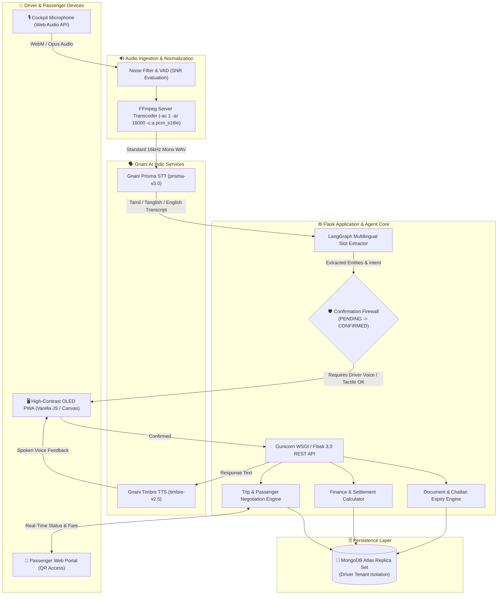

<div align="center">

# 🚖 T2T-DRIVE

### Noise-Aware, Multilingual AI Voice Co-Pilot for Auto-Rickshaw and Cab Drivers

[](https://www.python.org/)
[](https://flask.palletsprojects.com/)
[](https://langchain-ai.github.io/langgraph/)
[](https://www.mongodb.com/atlas)
[](https://gnani.ai/)
[](https://t2t-drive.onrender.com/)
[](LICENSE)

**"Speak Naturally. Manage Intelligently. Drive Smarter."**

[🚀 Live Driver Cockpit](https://t2t-drive.onrender.com/) • [📱 Passenger Portal](https://t2t-drive.onrender.com/passenger) • [🩺 Health Telemetry](https://t2t-drive.onrender.com/api/health) • [📖 Documentation](#table-of-contents)

</div>

---

## 📋 Table of Contents

- [Overview](#-overview)
- [Key Innovations & Differentiators](#-key-innovations--differentiators)
- [System Architecture](#-system-architecture)
- [Core Features](#-core-features)
  - [1. Multilingual Voice Co-Pilot](#1-multilingual-voice-co-pilot)
  - [2. The Confirmation Firewall](#2-the-confirmation-firewall)
  - [3. Trip Lifecycle & QR Passenger Portal](#3-trip-lifecycle--qr-passenger-portal)
  - [4. Daily Finance & Owner Settlement](#4-daily-finance--owner-settlement)
  - [5. Digital Glovebox & Compliance Tracker](#5-digital-glovebox--compliance-tracker)
  - [6. Noise Intelligence Engine](#6-noise-intelligence-engine)
- [Tech Stack](#-tech-stack)
- [Project Structure](#-project-structure)
- [Quick Start & Local Setup](#-quick-start--local-setup)
- [Environment Configuration](#-environment-configuration)
- [API Reference](#-api-reference)
- [Test Suite & Quality Assurance](#-test-suite--quality-assurance)
- [Production Deployment (Render)](#-production-deployment-render)
- [Security, Privacy & Ethics](#-security-privacy--ethics)
- [License](#-license)

---

## 🌟 Overview

Operating an auto-rickshaw or taxi in urban India is demanding: drivers endure extreme ambient noise (65–85 dB from two-stroke engines, horn blasts, and monsoon downpours), fragmented income channels, predatory vehicle rental structures, and strict documentation compliance under the Motor Vehicles Act. Navigating touchscreens while driving is hazardous, yet existing apps force manual data entry.

**T2T-DRIVE** is an edge/cloud hybrid, voice-first digital co-pilot built specifically for transport operators. Powered by **Gnani AI's Indic speech stack** and **LangGraph NLU**, T2T-DRIVE enables drivers to record collections, manage fuel expenses, negotiate trips, coordinate with passengers, reconcile daily owner rent, and track permit renewals—completely hands-free in **Tamil**, **Tanglish (Romanized Tamil)**, and **Indian English**.

---

## 💡 Key Innovations & Differentiators

| Capability | Traditional Apps | **T2T-DRIVE** |
| :--- | :--- | :--- |
| **Voice Interface** | Generic English/Hindi cloud ASR | **Tamil, Tanglish & English** tuned for automotive vernacular & slang |
| **Acoustic Resilience** | Fails in high-noise street environments | **VAD, SNR filtering (120–400 Hz engine hum suppression)** + FFmpeg 16kHz WAV normalization |
| **Data Safety** | Blind auto-commit on voice recognition | **Zero Phantom Commit Firewall**: Two-stage staging (`PENDING` $\to$ `CONFIRMED`) |
| **Passenger Interaction**| Requires third-party aggregator app | **Lightweight QR Web Portal**: Real-time fare & destination negotiation via HMAC tokens |
| **Fleet & Settlements** | Manual paper logbooks | **Automated Owner-Driver Bhatta Reconciliation** with variance badges |
| **Frontend Overhead** | Heavy React/Vue bundle (OOM risk on low-end phones)| **Zero-Dependency Vanilla JS/CSS PWA** with 48px+ touch targets & OLED dark mode |

---

## 🏗️ System Architecture



---

## 🚀 Core Features

### 1. Multilingual Voice Co-Pilot
- **Indic-Native Speech Recognition:** Built with **Gnani Prisma STT** (`prisma-v3.0`) supporting native Tamil script, Latin-script Tanglish (*"Inniku collection 1500, petrol 300"*), and Indian English.
- **Natural Indic Text-to-Speech:** Real-time spoken confirmation through **Gnani Timbre TTS** (`timbre-v2.5`) with authentic colloquial intonation.
- **Multi-Entity Parsing:** Extracts multiple transaction items, amounts, locations, and intents in a single breath.

### 2. The Confirmation Firewall
Financial accuracy and passenger safety require zero errors:
- **No Direct Writes:** Extracted voice intents are never immediately committed to the financial ledger or trip database.
- **State Machine Workflow:** `UNCONFIRMED` $\to$ `PENDING` $\to$ `CONFIRMED` $\to$ `CONSUMED`.
- **Dual Confirmation Channels:** Drivers can confirm or cancel via voice ("Aama", "Sari", "Yes", "Vendam", "No") or high-contrast 48px tactile screen buttons.

### 3. Trip Lifecycle & QR Passenger Portal
- **Interactive Trip Management:** Voice-controlled lifecycle states: `REQUESTED` $\to$ `ACCEPTED` $\to$ `IN_PROGRESS` $\to$ `COMPLETED` $\to$ `CANCELLED`.
- **Dynamic Fare Negotiation:** Fare calculation based on distance, pickup/drop zones, and waiting time.
- **Passenger Companion Web App (`/passenger`):** Auto drivers display a vehicle-mounted QR code. Passengers scan to view live route progress, trip details, and propose mid-ride destination or fare changes without installing an app.
- **Cryptographic Security:** Passenger sessions use stateless HMAC-SHA256 signed access tokens with 4-hour expiration.

### 4. Daily Finance & Owner Settlement
- **Driver Income & Expense Ledger:** Categorizes fuel (petrol/diesel/CNG), vehicle repairs, toll charges, tea/bhatta, and passenger collections.
- **Visual Analytics:** Native HTML5 Canvas bar and donut charts running at 60 FPS without external JavaScript charting libraries.
- **Owner Settlement Calculator:** Reconciles daily driver collections against owner targets:
  - 🟢 `MATCHED` — Complete daily dues settled.
  - 🟡 `DRIVER SURPLUS` — Driver paid advance or excess.
  - 🔴 `DUE TO OWNER` — Pending rent or fuel deductions.

### 5. Digital Glovebox & Compliance Tracker
- **Document Management:** Monitors Driving Licence, Commercial Insurance, Vehicle Permit, Fitness Certificate (FC), and Pollution (PUC).
- **Proactive Expiry Alarms:** Visual countdowns with color-coded severity:
  - 🔴 **Critical:** $\le 7$ days or expired.
  - 🟡 **Warning:** $\le 30$ days.
  - 🟢 **Compliant:** $> 30$ days.
- **Traffic Challan Alerts:** Tracks outstanding traffic penalties and Motor Vehicles Act fines.

### 6. Noise Intelligence Engine
- **Voice Activity Detection (VAD):** Filters silence and non-speech cockpit sounds.
- **Signal-to-Noise Ratio (SNR) Analysis:** Detects and flags degraded audio captured near heavy traffic or rain.
- **Server-Side FFmpeg Normalization:** Transcodes arbitrary browser `MediaRecorder` audio (WebM/Opus, OGG, MP4) into genuine 16kHz 16-bit mono PCM WAV (`-ac 1 -ar 16000 -c:a pcm_s16le`) with validated RIFF headers prior to upstream STT submission.

---

## 🛠️ Tech Stack

### Backend
- **Language:** Python 3.11+
- **Framework:** Flask 3.0.3, Flask-CORS 4.0.1
- **WSGI Production Server:** Gunicorn 22.0.0 (workers: 1, threads: 4, timeout: 120s)
- **Agent Orchestration:** LangGraph 1.2+, LangChain-Core 1.7+
- **Data Validation:** Pydantic 2.7.1
- **Security & Auth:** PyJWT 2.8.0, bcrypt 4.1.2, Secrets API

### Speech & Audio AI
- **Speech-to-Text (ASR):** Gnani AI Prisma STT (`prisma-v3.0`)
- **Text-to-Speech (TTS):** Gnani AI Timbre TTS (`timbre-v2.5`)
- **Audio Processing:** `imageio-ffmpeg`, Web Audio API (AnalyserNode, BiquadFilterNode)

### Persistence & Storage
- **Primary Database:** MongoDB Atlas Replica Set (PyMongo 4.7.2, certifi, dnspython)
- **In-Memory Testing:** mongomock 4.1.2

### Frontend Cockpit
- **Markup & Styling:** Vanilla HTML5, CSS3 Custom Properties (Design Tokens), Mobile-First Responsive Grid
- **Scripting:** Pure Vanilla ES6+ JavaScript (Zero external npm libraries or bundlers)
- **Rendering:** HTML5 Canvas 2D for lightweight charts
- **Architecture:** Hash-based SPA (`#home`, `#finance`, `#documents`, `#settlement`, `#vehicle`, `#agent`)

---

## 📁 Project Structure

```text
T2T-DRIVE/
├── .env.example                         # Environment configuration template
├── .gitignore                           # Git exclusion rules
├── requirements.txt                     # Root dependencies for Render deployment
├── run.py                               # Local development runner
├── wsgi.py                              # Production WSGI entry point
├── README.md                            # Comprehensive project documentation
│
├── backend/
│   ├── requirements.txt                 # Backend Python package requirements
│   ├── app/
│   │   ├── __init__.py                  # Flask application factory (create_app)
│   │   ├── config.py                    # Environment variable parsing & validation
│   │   ├── agent/                       # LangGraph agent definitions & prompts
│   │   ├── database/                    # MongoDB Atlas connection & health check
│   │   ├── models/                      # Pydantic data models (Trip, Finance, Doc)
│   │   ├── repositories/                # Database query abstractions
│   │   ├── routes/                      # Flask Blueprints (REST endpoints)
│   │   │   ├── agent_routes.py          # AI reasoning & intent extraction
│   │   │   ├── auth_routes.py           # Driver authentication & OTP login
│   │   │   ├── challan_routes.py        # Traffic challans & fines
│   │   │   ├── document_routes.py       # Vehicle document vault
│   │   │   ├── finance_routes.py        # Daily income/expense transactions
│   │   │   ├── frontend_routes.py       # Cockpit & Passenger SPA static serving
│   │   │   ├── health_routes.py         # /api/health telemetry endpoint
│   │   │   ├── maintenance_routes.py    # Service telemetry & garage logs
│   │   │   ├── passenger_routes.py      # QR passenger interaction & negotiation
│   │   │   ├── pending_action_routes.py # Confirmation firewall staging
│   │   │   ├── settlement_routes.py     # Owner-driver bhatta reconciliation
│   │   │   ├── trip_routes.py           # Driver trip lifecycle management
│   │   │   └── voice_routes.py          # STT upload, FFmpeg transcoding, TTS
│   │   ├── schemas/                     # API request/response serialization
│   │   ├── services/                    # Business logic implementations
│   │   ├── utils/                       # Security, token generation, audio utils
│   │   └── voice/                       # Gnani Prisma & Timbre API adapters
│   │
│   └── tests/                           # Pytest test suite (390+ unit & integration tests)
│
└── frontend/
    ├── index.html                       # Driver Cockpit Single Page Application
    ├── passenger.html                   # Passenger Companion QR Web App
    ├── css/
    │   ├── style.css                    # OLED dark mode tokens, buttons, cockpit UI
    │   └── responsive.css               # Mount & phone responsive breakpoints
    ├── js/
    │   ├── app.js                       # SPA router & application lifecycle
    │   ├── api.js                       # REST client wrapper
    │   ├── voice.js                     # PTT recorder, audio visualizer, confirmation
    │   ├── finance.js                   # Ledger & Canvas charts
    │   ├── documents.js                 # Glovebox document countdowns
    │   ├── settlement.js                # Owner reconciliation engine
    │   ├── vehicle.js                   # Maintenance logs
    │   └── agent.js                     # AI trace & diagnostic inspector
    └── assets/                          # SVG icons and visual brand assets
```

---

## ⚡ Quick Start & Local Setup

### 1. Prerequisites
- **Python:** Version 3.11 or higher
- **Git:** Version 2.30+
- **MongoDB:** Local instance or free [MongoDB Atlas](https://www.mongodb.com/atlas) cluster
- **FFmpeg:** Optional locally (bundled automatically via `imageio-ffmpeg` in Python)

### 2. Clone the Repository
```bash
git clone https://github.com/Thirumugilathavan/T2T-DRIVE.git
cd T2T-DRIVE
```

### 3. Setup Virtual Environment
```bash
# Windows (PowerShell)
python -m venv backend\.venv
backend\.venv\Scripts\Activate.ps1

# Linux / macOS
python3 -m venv backend/.venv
source backend/.venv/bin/activate
```

### 4. Install Dependencies
```bash
pip install --upgrade pip
pip install -r requirements.txt
```

### 5. Configure Environment Variables
Copy the template and set up your local secrets:
```bash
cp .env.example backend/.env
```
*(See [Environment Configuration](#-environment-configuration) for required keys).*

### 6. Start the Local Server
```bash
python run.py
```
- Driver Dashboard: `http://localhost:5000/`
- Passenger Portal: `http://localhost:5000/passenger`
- API Health Status: `http://localhost:5000/api/health`

---

## ⚙️ Environment Configuration

| Variable | Type | Default | Description |
| :--- | :--- | :--- | :--- |
| `FLASK_ENV` | `string` | `development` | Environment mode (`development` or `production`) |
| `PORT` | `integer`| `5000` | HTTP listening port (assigned by Render in cloud) |
| `SECRET_KEY` | `string` | *(32+ chars)* | Session encryption secret key |
| `JWT_SECRET` | `string` | *(32+ chars)* | JSON Web Token signing key |
| `MONGODB_URI` | `string` | *(Atlas URI)* | MongoDB Atlas SRV connection string |
| `DB_NAME` | `string` | `t2t_drive` | Database name |
| `GNANI_BASE_URL` | `string` | `https://api.vachana.ai` | Base URL for Gnani AI Indic speech services |
| `GNANI_API_KEY` | `string` | *(API Key)* | Authentication key for Gnani Prisma & Timbre |
| `GNANI_PRISMA_ENABLED`| `int` | `1` | Enable live Prisma STT (`1` = active, `0` = mock) |
| `GNANI_TIMBRE_ENABLED`| `int` | `1` | Enable live Timbre TTS (`1` = active, `0` = mock) |
| `VOICE_PROVIDER_MODE` | `string` | `live` | Speech processing mode (`live` or `mock`) |
| `AUDIO_VAD_ENABLED` | `int` | `1` | Voice activity detection filter |
| `AUDIO_SNR_ENABLED` | `int` | `1` | Signal-to-noise ratio analyzer |

---

## 📡 API Reference

### Health & Telemetry
| Method | Endpoint | Description |
| :--- | :--- | :--- |
| `GET` | `/api/health` | Service status, MongoDB Atlas connectivity, voice provider readiness |

### Voice & Speech AI
| Method | Endpoint | Description |
| :--- | :--- | :--- |
| `POST` | `/api/voice/stt` | Ingests recorded WebM/WAV, normalizes via FFmpeg, returns Indic transcription |
| `POST` | `/api/voice/tts` | Converts text string into spoken audio stream via Gnani Timbre |
| `POST` | `/api/voice/turn` | Full-duplex voice turn (Audio $\to$ STT $\to$ NLU $\to$ Pending Action $\to$ TTS) |

### AI Agent & Confirmation Firewall
| Method | Endpoint | Description |
| :--- | :--- | :--- |
| `POST` | `/api/agent/process` | Analyzes text transcript, performs multilingual entity extraction |
| `GET` | `/api/pending-actions` | Fetches staged unconfirmed driver actions |
| `POST` | `/api/pending-actions/<id>/confirm` | Confirms action and commits to permanent database ledger |
| `POST` | `/api/pending-actions/<id>/reject` | Rejects/cancels staged action without side effects |

### Trips & Passenger Portal
| Method | Endpoint | Description |
| :--- | :--- | :--- |
| `POST` | `/api/trips` | Creates a new trip entry |
| `GET` | `/api/trips/active` | Retrieves current active trip |
| `PATCH`| `/api/trips/<id>/status` | Updates trip status (`ACCEPTED`, `IN_PROGRESS`, `COMPLETED`) |
| `GET` | `/api/passenger/trips/<id>` | Authenticated passenger portal trip status view |
| `POST` | `/api/passenger/trips/<id>/propose-change` | Passenger proposes destination or fare update |

### Finance & Settlements
| Method | Endpoint | Description |
| :--- | :--- | :--- |
| `GET` | `/api/finance/summary` | Today's collections, expenses, fuel, and net take-home |
| `POST` | `/api/finance/transactions` | Logs income or expense record |
| `GET` | `/api/settlements/reconcile` | Computes driver collection vs. owner target variance |

### Documents & Maintenance
| Method | Endpoint | Description |
| :--- | :--- | :--- |
| `GET` | `/api/documents` | Glovebox documents list with remaining expiry days |
| `GET` | `/api/challans` | Unpaid traffic fines and violations |
| `GET` | `/api/maintenance/schedule` | Vehicle service intervals (oil, brakes, clutch) |

---

## 🧪 Test Suite & Quality Assurance

The codebase includes **390+ automated tests** verifying every layer from audio transcoding and NLU slot-filling to database transactions and firewall safety:

```bash
# Run complete test suite
pytest backend/tests -v

# Run with short progress summary
pytest backend/tests -q

# Run specific functional test suites
pytest backend/tests/test_voice_routes.py
pytest backend/tests/test_agent_pipeline.py
pytest backend/tests/test_confirmation_firewall.py
pytest backend/tests/test_passenger_api.py
```

### Safety & Integrity Guarantees
- **Mock Fallback Isolation:** In production mode (`FLASK_ENV=production`), silent mock fallbacks are completely forbidden. If a dependency is unreachable, the system truthfully returns HTTP 503 instead of fabricating data.
- **Credential Masking:** Zero logging of passwords, tokens, or raw speech recordings in server console output.

---

## ☁️ Production Deployment (Render)

T2T-DRIVE is configured for single-service deployment on **Render**:

1. **Repository:** Connect `https://github.com/Thirumugilathavan/T2T-DRIVE` to Render.
2. **Environment:** `Python 3`
3. **Build Command:**
   ```bash
   pip install --upgrade pip && pip install -r requirements.txt
   ```
4. **Start Command:**
   ```bash
   gunicorn --chdir backend --workers 1 --threads 4 --timeout 120 --bind 0.0.0.0:$PORT wsgi:app
   ```
5. **Worker Sizing:** `--workers 1 --threads 4` is calibrated for the 512 MB memory limit of Render Free instances, preventing Out-Of-Memory (OOM) crashes while supporting concurrent audio streaming.
6. **Network Access:** Ensure MongoDB Atlas IP Access List contains `0.0.0.0/0` to allow Render's dynamic outbound IPs.

---

## 🔒 Security, Privacy & Ethics

- **Tenant Isolation:** Every financial record, document, and trip is strictly scoped to the authenticated `driver_id`.
- **Acoustic Privacy:** Audio recordings are processed in-memory / temporary scratch buffers and immediately deleted after transcription. No passenger conversations are retained.
- **Zero Hallucination Writes:** The AI agent possesses read-only access to query records; state mutations can only occur when signed off through the Confirmation Firewall.

---

## 📄 License

This project is licensed under the **MIT License** — see the [LICENSE](LICENSE) file for details.

---

<div align="center">
  <b>T2T-DRIVE</b> • Built with ❤️ for India's Hardworking Transport Operators
</div>
