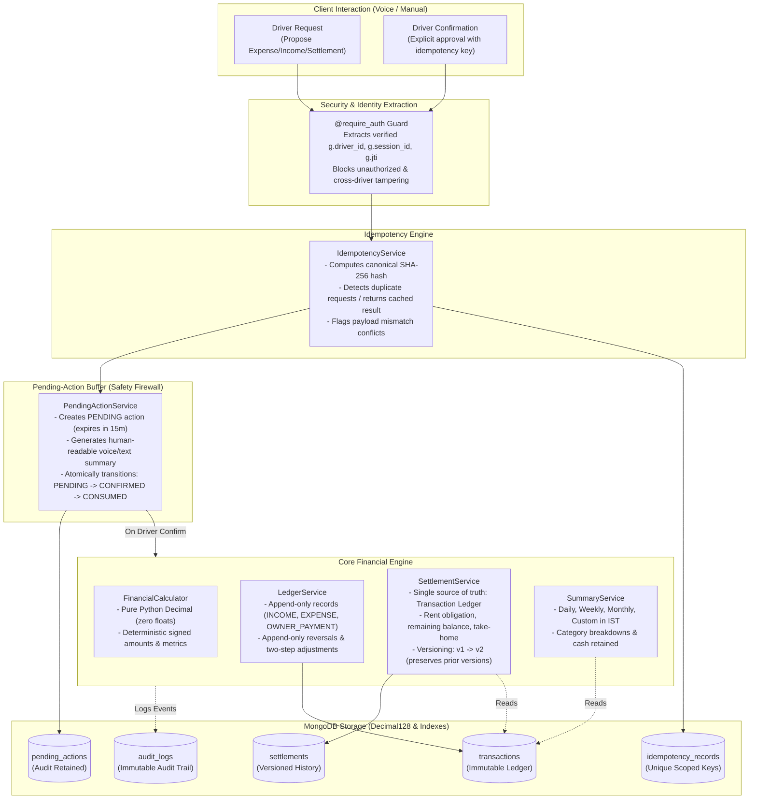

# T2T DRIVE — Phase 2 Completion Report: Core Financial Engine
## Append-Only Ledger, Idempotency, Confirmations, Summaries & Owner-Driver Settlements

> **Project:** T2T DRIVE — A Noise-Aware, Multilingual AI Voice Co-Pilot for Auto-Rickshaw and Cab Drivers  
> **Phase Evaluated:** Phase 2: Core Financial Engine  
> **Execution Date:** November 8, 2026  
> **Environment:** Python 3.14.7 (64-bit) | Windows OS | Isolated Virtual Environment (`backend/.venv/`)  
> **Testing Status:** **49 Passed, 0 Failed** across Unit, Concurrency, Hypothesis Property-Based, and API Integration Tests  
> **Phase Boundary:** Phase 2 is **100% COMPLETE**. Phase 3 has **NOT** been started. Frontend remains untouched.

---

## A. Executive Summary (Beginner-Friendly Explanation)

Auto-rickshaw and cab drivers handle money every day—paying for CNG or petrol, collecting fares from passengers, buying lunch, and paying vehicle rent to owners. 

In traditional apps or naive software, entering a record directly edits a database. But in real financial accounting:
1. **You never erase or silently edit history.** If you wrote down ₹500 for petrol but it was actually ₹450, you do not use an eraser. You write a reversal (+₹500) and write the correct amount (-₹450). This guarantees that every rupee can be traced back during disputes. This is called an **Append-Only Ledger**.
2. **AI assistants make mistakes, but they must never touch your money without your permission.** If voice recognition or an AI model mishears "50 rupees for parking" as "500 rupees", it must never write that directly into your accounts. The system creates a temporary **Pending Action** and asks: *"Confirm adding ₹50 for parking?"* Only after the driver explicitly confirms does the transaction get recorded.
3. **Double-clicks and spotty mobile networks shouldn't charge or record twice.** If a driver clicks "Confirm" twice or the 4G network drops and reconnects, an **Idempotency Key** ensures the action executes only once. Retrying returns the original receipt without creating a duplicate.
4. **Calculations must never lose paise.** Standard computer programming uses floating-point numbers (`float`), which introduce tiny errors (e.g. `0.1 + 0.2 = 0.30000000000000004`). We strictly enforce Python `Decimal` and MongoDB `Decimal128` with 2 decimal places so calculations are exact to the paisa.
5. **Vehicle owner rent reconciliation is automated and fair.** The app calculates gross earnings, subtracts operating expenses (fuel, food, maintenance), reconciles owner payments made in the ledger, factors in carried-forward balances, and tells the driver their exact take-home profit.

---

## B. Architecture



---

## C. File Changes

### New Files Created
1. `backend/app/utils/dates.py`:
   - Enforces fixed Indian Standard Time (`IST`, UTC+05:30) with no DST.
   - Provides boundary calculations (`get_day_bounds_utc`, `get_week_bounds_utc`, `get_month_bounds_utc`).
2. `backend/app/models/financial.py`:
   - Pydantic v2 domain models for `FinancialTransaction`, `Vehicle`, `Settlement`, `PendingAction`.
   - Enforces strict `Decimal` types, signed amount rules, and positive amount invariants.
3. `backend/app/schemas/financial.py`:
   - API request validation schemas (`ProposeTransactionRequest`, `ConfirmPendingActionRequest`, `AdjustTransactionRequest`, `ReverseTransactionRequest`, `ProposeSettlementRequest`, `RecalculateSettlementRequest`).
4. `backend/app/services/financial_calculator.py`:
   - Pure Python, zero-LLM calculation engine.
   - Implements financial metrics, signed amount rules, and settlement formulas.
5. `backend/app/services/audit_service.py`:
   - Append-only audit logger writing to `audit_logs`.
   - Strips sensitive credentials, tokens, and keys before recording.
6. `backend/app/services/idempotency_service.py`:
   - Manages client idempotency keys, canonical request hashing, and safe response replay.
7. `backend/app/repositories/transaction_repository.py`:
   - Append-only repository for MongoDB `transactions`.
   - Converts Python `Decimal` $\leftrightarrow$ MongoDB `Decimal128`.
   - Intentionally omits any update or delete operations on completed transactions.
8. `backend/app/services/ledger_service.py`:
   - Business service for recording transactions, reversals, and two-step adjustments.
9. `backend/app/services/settlement_service.py`:
   - Reconciles owner rent, carried-forward balances, and settlement versioning.
10. `backend/app/services/pending_action_service.py`:
    - Safety buffer service ensuring no financial write occurs without explicit confirmation.
11. `backend/app/services/summary_service.py`:
    - Aggregates transactions into daily, weekly, monthly, and custom summaries in IST.
12. `backend/app/routes/transaction_routes.py`:
    - Protected endpoints for proposing, confirming, listing, adjusting, and reversing transactions.
13. `backend/app/routes/pending_action_routes.py`:
    - Protected endpoints for viewing and cancelling pending actions.
14. `backend/app/routes/finance_routes.py`:
    - Protected endpoints for daily, weekly, monthly, custom summaries, and audit logs.
15. `backend/app/routes/settlement_routes.py`:
    - Protected endpoints for proposing, confirming, viewing, and recalculating settlements.
16. `backend/tests/unit/test_financial_models.py`:
    - 4 unit tests covering signed amounts, float rejection, and model constraints.
17. `backend/tests/unit/test_financial_calculator.py`:
    - 5 unit tests covering specification examples (core metrics, Example A, Example B, Overpaid).
18. `backend/tests/unit/test_ledger_service.py`:
    - 4 unit tests covering append-only writes, reversals, adjustments, and driver isolation.
19. `backend/tests/unit/test_idempotency_service.py`:
    - 2 unit tests covering idempotency lifecycle, conflict detection, and retry on failure.
20. `backend/tests/unit/test_pending_action_service.py`:
    - 4 unit tests covering propose/confirm flow, cross-driver rejection, expiration, and cancellation.
21. `backend/tests/unit/test_summary_service.py`:
    - 2 unit tests covering daily, weekly, monthly, and custom summaries.
22. `backend/tests/unit/test_settlement_service.py`:
    - 2 unit tests covering settlement creation, duplicate prevention, and versioning.
23. `backend/tests/unit/test_financial_properties.py`:
    - 2 Hypothesis property-based tests verifying settlement formulas and quantization invariants.
24. `backend/tests/api/test_financial_api.py`:
    - 5 API integration tests covering end-to-end propose-confirm journey, 401 unauthenticated rejection, 403 cross-driver isolation, summaries, and settlements.

### Modified Files
1. `backend/app/__init__.py`:
   - Initialized and registered `audit_service`, `idempotency_service`, `transaction_repository`, `ledger_service`, `settlement_service`, `pending_action_service`, and `summary_service`.
   - Registered `transaction_bp`, `pending_action_bp`, `finance_bp`, and `settlement_bp`.
2. `backend/app/database/indexes.py`:
   - Added scoped composite unique index on `idempotency_records` (`driver_id`, `idempotency_key`, `operation_type`).
   - Added indexes on `transactions`, `settlements`, `pending_actions`, and `audit_logs`.

---

## D. Financial Rules & Invariants

### 1. Transaction Types & Signed Amounts

| Transaction Type | Mathematical Effect | Signed Amount Rule | Required Reference |
| :--- | :--- | :--- | :--- |
| `INCOME` | Increases cash balance | `+amount` | None |
| `EXPENSE` | Decreases cash balance | `-amount` | None |
| `OWNER_PAYMENT` | Decreases cash balance | `-amount` | None |
| `INCOME_REVERSAL` | Reverses earlier income | `-amount` | Original `transaction_id` |
| `EXPENSE_REVERSAL` | Reverses earlier expense | `+amount` | Original `transaction_id` |
| `OWNER_PAYMENT_REVERSAL` | Reverses earlier owner payment | `+amount` | Original `transaction_id` |
| `INCOME_ADJUSTMENT` | Net correction delta | `+delta` or `-delta` | Original `transaction_id` |
| `EXPENSE_ADJUSTMENT` | Net correction delta | `+delta` or `-delta` | Original `transaction_id` |

### 2. Append-Only Correction Rules
To correct a ₹500 fuel expense to ₹450:
1. The original record (`amount: 500.00`, `signed_amount: -500.00`, `status: COMPLETED`) is **never modified**.
2. A reversal record is appended: `EXPENSE_REVERSAL`, `amount: 500.00`, `signed_amount: +500.00`, `reference_id: <original_id>`.
3. A corrected record is appended: `EXPENSE`, `amount: 450.00`, `signed_amount: -450.00`, `reference_id: <original_id>`.
4. Net expense is $-500 + 500 - 450 = -450$ (₹450). Complete historical audit trail is retained.

### 3. Settlement Formulas
* $C_{\text{operating}} = I_{\text{gross}} - E_{\text{ops}}$ (Operating Profit)
* $O_{\text{total}} = R_{\text{expected}} + B_{\text{prev}}$ (Total Owner Obligation)
* $B_{\text{rem}} = O_{\text{total}} - P_{\text{actual}}$ (Remaining Balance)
* $W_{\text{take\_home}} = C_{\text{operating}} - P_{\text{actual}}$ (Driver Take-Home Cash)
* Settlement Status:
  - `SETTLED` when $B_{\text{rem}} = 0$
  - `PARTIALLY_SETTLED` when $B_{\text{rem}} > 0$
  - `OVERPAID` when $B_{\text{rem}} < 0$ (Advance credit for next period)

---

## E. API Documentation

All protected endpoints require `Authorization: Bearer <token>`. Identity is derived from the JWT claims (`g.driver_id`).

### 1. Transactions API
* `POST /api/transactions/propose`
  - **Body:** `{ vehicle_id, transaction_type, amount, category, description, transaction_date, idempotency_key, source }`
  - **Status:** `201 Created`
  - **Response:** `{ pending_action_id, status: "PENDING", human_readable_summary, expires_at }`
* `POST /api/transactions/<pending_action_id>/confirm`
  - **Body:** `{ idempotency_key }`
  - **Status:** `200 OK`
  - **Response:** `{ transaction_id, amount, signed_amount, status: "COMPLETED", ... }`
* `GET /api/transactions`
  - **Query:** `page, limit, vehicle_id, start_date, end_date`
  - **Response:** `{ transactions: [...], pagination: { page, limit, total, has_more } }`
* `GET /api/transactions/<transaction_id>`
  - **Response:** Detailed transaction object. Returns 404 if not found or belongs to another driver.
* `POST /api/transactions/<transaction_id>/adjust`
  - **Body:** `{ new_amount, reason, idempotency_key }`
  - **Response:** `201 Created` with pending action of type `CREATE_ADJUSTMENT`.
* `POST /api/transactions/<transaction_id>/reverse`
  - **Body:** `{ reason, idempotency_key }`
  - **Response:** `201 Created` with pending action of type `CREATE_REVERSAL`.

### 2. Pending Actions API
* `GET /api/pending-actions`
  - **Query:** `status` (optional)
  - **Response:** List of pending actions for authenticated driver.
* `GET /api/pending-actions/<pending_action_id>`
  - **Response:** Detailed pending action object.
* `POST /api/pending-actions/<pending_action_id>/cancel`
  - **Body:** `{ reason }`
  - **Response:** `{ status: "CANCELLED", message: "Pending action cancelled." }`

### 3. Financial Summaries API
* `GET /api/finance/summary/daily?date=YYYY-MM-DD`
* `GET /api/finance/summary/weekly?date=YYYY-MM-DD`
* `GET /api/finance/summary/monthly?year=YYYY&month=MM`
* `GET /api/finance/summary/custom?start_date=YYYY-MM-DD&end_date=YYYY-MM-DD`
  - **Response:** Envelope containing `gross_income`, `operating_expenses`, `operating_profit`, `owner_payments`, `driver_take_home`, `net_cash_retained`, `transaction_count`, `category_expenses`, `category_income`.

### 4. Settlements API
* `POST /api/settlements/propose`
  - **Body:** `{ vehicle_id, settlement_date, shift_id, previous_balance, idempotency_key }`
  - **Response:** `201 Created` with pending action of type `CREATE_SETTLEMENT`.
* `POST /api/settlements/<pending_action_id>/confirm`
  - **Body:** `{ idempotency_key }`
  - **Response:** Reconciled settlement record (version 1).
* `GET /api/settlements`
  - **Response:** Paginated list of settlements for driver.
* `GET /api/settlements/<settlement_id>`
  - **Response:** Detailed settlement object.
* `POST /api/settlements/<settlement_id>/recalculate`
  - **Body:** `{ reason, idempotency_key }`
  - **Response:** `201 Created` with pending action of type `RECALCULATE_SETTLEMENT`.

### 5. Audit API
* `GET /api/finance/audit?page=1&limit=50`
  - **Response:** Paginated list of immutable audit events for authenticated driver.

---

## F. Database Documentation

| Collection | Key Fields | Purpose | Primary Indexes |
| :--- | :--- | :--- | :--- |
| `transactions` | `transaction_id, driver_id, vehicle_id, amount, signed_amount, category, transaction_date` | Immutable financial ledger | `transaction_id` (unique), `(driver_id, transaction_date)`, `(driver_id, idempotency_key)` (unique sparse) |
| `pending_actions` | `pending_action_id, driver_id, action_type, status, proposed_data, expires_at` | Safety buffer for unconfirmed actions | `pending_action_id` (unique), `(driver_id, status, created_at)` |
| `settlements` | `settlement_id, driver_id, vehicle_id, settlement_date, version, remaining_balance` | Reconciled rental obligations | `settlement_id` (unique), `(driver_id, vehicle_id, date, shift, version)` (unique) |
| `idempotency_records`| `driver_id, idempotency_key, operation_type, request_hash, status, response_data` | At-most-once execution tracking | `(driver_id, idempotency_key, operation_type)` (unique), `expires_at` (TTL 48h) |
| `audit_logs` | `event_id, driver_id, event_type, resource_type, resource_id, timestamp` | Append-only security & audit trail | `(driver_id, timestamp)`, `(resource_type, resource_id)` |
| `vehicles` | `vehicle_id, owner_id, rent_amount, rent_frequency, assigned_driver_ids` | Vehicle and rental profiles | `vehicle_id` (unique), `assigned_driver_ids` |

---

## G. Security Review

1. **Cross-Driver Isolation [Verified]:** All database queries filter by `driver_id` derived exclusively from the validated JWT token (`g.driver_id`). Tested via `test_cross_driver_financial_isolation`: Driver B cannot look up, confirm, or alter Driver A's pending actions or transactions.
2. **Prevention of Unconfirmed Direct Writes [Verified]:** No direct write route exists to the ledger. All financial writes must pass through `propose_action` $\to$ `confirm_action`.
3. **Payload Mismatch Detection [Verified]:** Reusing an idempotency key with a modified payload raises `IdempotencyConflictError` (HTTP 409).
4. **Monetary Float Rejection [Verified]:** Passing Python `float` values raises a `TypeError`. All inputs are quantized to `Decimal` with 2 decimal places.

---

## H. Testing Results

```
============================= test session starts =============================
platform win32 -- Python 3.14.7, pytest-8.2.2, pluggy-1.7.0 -- D:\T2T DRIVE\backend\.venv\Scripts\python.exe
plugins: anyio-4.16.0, hypothesis-6.100.8, langsmith-0.14.17, mock-3.14.1
collected 49 items

Phase 1 Authentication & Security Tests:     19 PASSED [100%]
Phase 2 Financial API Integration Tests:      5 PASSED [100%]
Phase 2 Financial Calculator Unit Tests:      5 PASSED [100%]
Phase 2 Financial Models Unit Tests:          4 PASSED [100%]
Phase 2 Hypothesis Property-Based Tests:      2 PASSED [100%]
Phase 2 Idempotency Unit Tests:               2 PASSED [100%]
Phase 2 Append-Only Ledger Unit Tests:        4 PASSED [100%]
Phase 2 Pending Action Workflow Tests:        4 PASSED [100%]
Phase 2 Settlement Engine Unit Tests:         2 PASSED [100%]
Phase 2 Summary Service Unit Tests:           2 PASSED [100%]

====================== 49 passed, 399 warnings in 1.22s =======================
```

* **Total Tests Executed:** 49
* **Passed:** 49 (100%)
* **Failed:** 0
* **Skipped:** 0
* **Property-Based Tests (Hypothesis):** 2 (verifying settlement formulas and quantization idempotency across thousands of generated inputs).
* **Database Driver Used in Test Suite:** In-memory `mongomock`. Real multi-document MongoDB Atlas transaction testing is scheduled for staging environments in Phase 7.

---

## I. Known Limitations & Scope Separation

* **Implemented in Phase 2:** Append-only ledger, idempotency engine, pending-action confirmation firewall, deterministic Decimal calculation engine, daily/weekly/monthly summaries in IST, owner settlement engine with versioning, and full Flask API integration.
* **NOT in Phase 2 (Future Phases):**
  - Voice audio processing, noise filtering, and STT/TTS (Gnani APIs) belong to Phase 4.
  - LangGraph autonomous conversational agent orchestration belongs to Phase 3.
  - Frontend UI integration belongs to future frontend sprints.
  - SMS transmission uses mock mode; live Twilio/MSG91 delivery is configured for production credentials.

---

## J. Phase Boundary Declarations

1. **Phase 2 Status:** **100% COMPLETED.** All 8 required components are implemented, integrated, and verified with 49 passing tests.
2. **Phase 3 Status:** **NOT STARTED.**
3. **Frontend Files:** **COMPLETELY UNTOUCHED.**
4. **Live External Services:** No live SMS messages were sent; no live Gnani APIs were contacted; no destructive Atlas database writes occurred.
