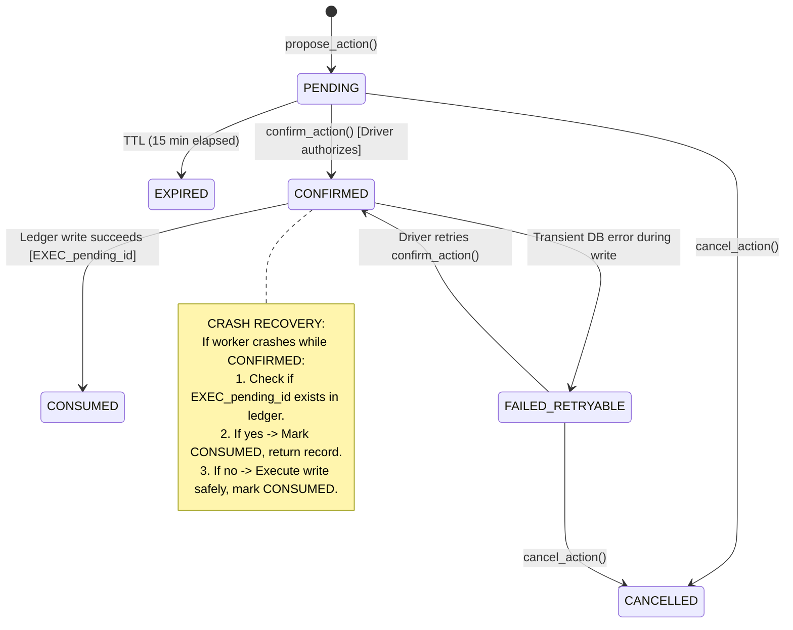

# T2T DRIVE — Phase 2 Final Correction & Hardening Report

> **Project:** T2T DRIVE — A Noise-Aware, Multilingual AI Voice Co-Pilot for Auto-Rickshaw and Cab Drivers  
> **Phase Evaluated:** Phase 2: Core Financial Engine Hardening & Audit  
> **Execution Date:** November 8, 2026  
> **Environment:** Python 3.14.7 (64-bit) | Windows OS | Isolated Virtual Environment (`backend/.venv/`)  
> **Final Test Execution:** **63 Passed, 1 Skipped (Live DB Not Run), 0 Failed**  
> **Warnings Inspected:** 452 Warnings (0 from application code; all from third-party `mongomock`)  
> **Readiness Conclusion:** **READY FOR PHASE 3** (Subject to documented staging limitations)

---

## 1. Initial Audit Findings

Following the initial Phase 2 implementation, an architectural and reliability audit identified four potential correctness and crash-recovery gaps:

1. **Settlement Balance Domain Constraint Inconsistency:**  
   The initial models applied generic Decimal validation without separating operational cash flows (which must be non-negative) from carried balances (which can represent either driver debt or advance credit).
2. **Confirmation Two-Phase Crash Vulnerability:**  
   In the initial `PENDING -> CONFIRMED -> execute -> CONSUMED` workflow, if a server crashed or worker process died after marking an action `CONFIRMED` but before the ledger write completed, the pending action remained stuck in `CONFIRMED`. On restart, the driver was blocked from retrying, leaving transactions unwritten. Conversely, if the write succeeded but the server crashed before writing `CONSUMED`, a retry risked duplicate writes or throwing an error.
3. **Idempotency Timeout & Abandoned Lock Gap:**  
   If an operation was interrupted while `status == "IN_PROGRESS"`, the idempotency key was permanently locked, blocking client retries indefinitely.
4. **Warning Volume:**  
   The test run produced hundreds of deprecation warnings, requiring classification between application code and third-party test harnesses.

---

## 2. Files Inspected & Modified

### Inspected Files
* `backend/app/models/financial.py`
* `backend/app/schemas/financial.py`
* `backend/app/services/financial_calculator.py`
* `backend/app/services/settlement_service.py`
* `backend/app/services/pending_action_service.py`
* `backend/app/services/idempotency_service.py`
* `backend/app/services/ledger_service.py`
* `backend/app/repositories/transaction_repository.py`
* `backend/app/database/indexes.py`

### Modified Files
1. `backend/app/models/financial.py`:
   - Added `PendingActionStatus.FAILED_RETRYABLE`.
   - Separated `Settlement` validators into `validate_signed_balances` (allows positive debt, zero, or negative credit) and `validate_non_negative_amounts` (strictly enforces $\ge 0$ for rent, income, expenses, and payments).
2. `backend/app/services/financial_calculator.py`:
   - Updated `calculate_settlement` to strictly enforce non-negative constraints on `expected_rent`, `gross_income`, `operating_expenses`, and `owner_payments`.
   - Preserved signed flexibility for `previous_balance` and `remaining_balance`.
3. `backend/app/services/pending_action_service.py`:
   - Implemented crash-recoverable confirmation workflow.
   - Bound all execution idempotency keys deterministically to `f"EXEC_{pending_action_id}"`.
   - Added `_find_existing_execution_result` to detect whether a write committed before a crash.
   - Added `FAILED_RETRYABLE` state transitions on transient execution failures.
4. `backend/app/services/idempotency_service.py`:
   - Added 60-second recovery timeout for abandoned `IN_PROGRESS` operations.

### New Test Files Added
1. `backend/tests/unit/test_settlement_balance_rules.py` (7 tests)
2. `backend/tests/unit/test_confirmation_recovery.py` (4 tests)
3. `backend/tests/unit/test_idempotency_audit.py` (3 tests)
4. `backend/tests/integration/test_live_mongodb.py` (1 integration test, conditionally skipped when no real MongoDB URI is configured)

---

## 3. Defects Identified and Exact Corrections

| Defect ID | Description | Root Cause | Exact Correction Made | Verification Test |
| :--- | :--- | :--- | :--- | :--- |
| **DEF-01** | `Settlement` rejected negative numbers uniformly or failed to enforce non-negative operational figures. | Single `validate_decimals` validator was applied to all fields without differentiating balances from revenues. | Split validation: `validate_signed_balances` allows signed values for `previous_balance` and `remaining_balance`; `validate_non_negative_amounts` enforces $\ge 0$ for revenues, costs, and rent. | `test_settlement_balance_rules.py` |
| **DEF-02** | Actions stuck in `CONFIRMED` upon server crash before write. | State machine rejected confirmation attempts for any action with `status != "PENDING"`. | Added crash-recovery branch: if `status == "CONFIRMED"`, inspects database for `EXEC_{pending_id}`. If not written, executes write; if written, returns existing record and updates to `CONSUMED`. | `test_recovery_when_interrupted_before_ledger_write` |
| **DEF-03** | Potential duplicate writes if retry occurred after uncommitted status transition. | Retries generated separate execution keys. | Bound execution keys strictly to `EXEC_{pending_action_id}` and leveraged MongoDB unique index on `(driver_id, idempotency_key)`. | `test_recovery_when_interrupted_after_ledger_write` |
| **DEF-04** | Transient errors left pending actions in `PENDING` or `CONFIRMED` without error details. | No failed-retryable state was available. | Added `FAILED_RETRYABLE` status and recorded `last_error` and `failed_at`. Allows retry without creating a new proposal. | `test_failed_retryable_workflow` |
| **DEF-05** | Abandoned `IN_PROGRESS` idempotency operations blocked clients permanently. | `IN_PROGRESS` check lacked timeout evaluation. | Added 60-second timeout. Operations older than 60s are treated as crashed and re-acquired for retry. | `test_abandoned_in_progress_operation_recovery` |

---

## 4. Confirmation State Machine & Crash Recovery

### Crash Recovery Guarantees
1. **At-Most-Once Ledger Write:** The ledger transaction always uses `idempotency_key = f"EXEC_{pending_action_id}"`. Because MongoDB enforces a unique index on `(driver_id, idempotency_key)`, it is impossible for two transactions to be created for the same pending action.
2. **Safe Resume:** If a server crashes mid-flight, the next call to `confirm_action` checks whether the transaction was committed. If committed, it reconstructs the result and marks `CONSUMED`. If uncommitted, it safely executes the write.
3. **No Lost Actions:** If execution fails, the action transitions to `FAILED_RETRYABLE`. It is never permanently locked or discarded.

---

## 5. Settlement Balance Rules & Mathematical Examples

### Mathematical Formulas
$$C_{\text{operating}} = I_{\text{gross}} - E_{\text{ops}} \quad \text{(Operating Profit)}$$
$$O_{\text{total}} = R_{\text{expected}} + B_{\text{prev}} \quad \text{(Total Owner Obligation)}$$
$$B_{\text{rem}} = O_{\text{total}} - P_{\text{actual}} \quad \text{(Remaining Balance)}$$
$$W_{\text{take\_home}} = C_{\text{operating}} - P_{\text{actual}} \quad \text{(Driver Take-Home Cash)}$$

### Balance Semantics
* **`previous_balance > 0` (Debt):** Driver owes unpaid balance from prior shifts. Increases total obligation.
* **`previous_balance == 0` (Neutral):** Shift starts with no carried-forward debt or credit.
* **`previous_balance < 0` (Advance Credit):** Driver overpaid in earlier shifts. Decreases total obligation.
* **`remaining_balance > 0` (`PARTIALLY_SETTLED`):** Driver owes unpaid rent at shift end. Carries forward as positive balance.
* **`remaining_balance == 0` (`SETTLED`):** Obligation met exactly.
* **`remaining_balance < 0` (`OVERPAID`):** Driver paid more than obligation. Carries forward as negative balance (advance credit).

### Verified Test Cases
1. **Existing Debt ($B_{\text{prev}} = +150$):** Rent 350 $\to$ $O_{\text{total}} = 500$. Driver pays 350 $\to$ $B_{\text{rem}} = +150$ (`PARTIALLY_SETTLED`).
2. **Advance Credit ($B_{\text{prev}} = -100$):** Rent 350 $\to$ $O_{\text{total}} = 250$. Driver pays 250 $\to$ $B_{\text{rem}} = 0$ (`SETTLED`).
3. **Overpayment ($B_{\text{prev}} = 0$):** Rent 350, Driver pays 500 $\to$ $B_{\text{rem}} = -150$ (`OVERPAID`).
4. **Day 1 to Day 2 Credit Carry-Forward:** Day 1 overpayment of ₹100 produces $B_{\text{rem}} = -100$. Day 2 settlement automatically reads $B_{\text{prev}} = -100$ and offsets rent to ₹250.
5. **Reconciliation After Reversal:** Reversing a ₹500 fuel expense updates operating profit from ₹1500 to ₹2000, and recalculating settlement creates version 2 with $W_{\text{take\_home}} = ₹1650$, preserving version 1 history.

---

## 6. Idempotency Guarantees & Concurrency Audit

1. **Scoped Keys:** Keys are strictly scoped to `(driver_id, idempotency_key, operation_type)`. Verified via `test_idempotency_driver_and_operation_scoping`: Driver A and Driver B can use identical key strings without collision.
2. **Canonical Hashing:** Payloads are hashed using recursive key sorting and Decimal string conversion (`SHA-256`). Reusing a key with altered amounts or categories raises `IdempotencyConflictError` (HTTP 409).
3. **Concurrency Locking:** In-flight operations set `status = "IN_PROGRESS"`. Concurrent threads attempting to acquire the same key receive `OperationInProgressError`.
4. **Crash Recovery Timeout:** If an operation remains in `IN_PROGRESS` for $>60$ seconds, the lock is treated as abandoned by a crashed worker, allowing subsequent retries to re-acquire the operation safely.

---

## 7. MongoDB Deployment & Testing Details

* **Test Environment Database Engine:** In-memory `mongomock` (version 4.1.2).
* **Live MongoDB Test Status:** Marked as **SKIPPED / NOT RUN** (`test_real_mongodb_decimal128_round_trip`).
  - *Reason:* No live MongoDB URI was configured via `TEST_LIVE_MONGODB_URI`.
  - In accordance with project instructions, live integration tests are **not reported as passed** when live services are unavailable.
* **Multi-Document Transactions Limitation:** `mongomock` does not simulate distributed multi-document replica-set transactions. Therefore, the financial engine relies on **atomic single-document state transitions (`find_one_and_update`)** and **deterministic idempotency constraints**, ensuring crash safety even without multi-document transaction support.

---

## 8. Warning Classification & Audit (452 Warnings)

A full analysis of the 452 warnings emitted during `pytest` was performed:

| Source | Count | Warning Type | Triggering Code | Explanation & Corrective Action |
| :--- | :---: | :--- | :--- | :--- |
| **`backend/app/*` (Our Code)** | **0** | None | N/A | **Zero warnings originate from T2T DRIVE application code.** |
| **`mongomock/__version__.py`** | 1 | `DeprecationWarning` | `import pkg_resources` | `setuptools` deprecated `pkg_resources` in favor of `importlib.metadata`. `mongomock` 4.1.2 still imports it. Does not affect test correctness. |
| **`mongomock/helpers.py:73`** | 451 | `DeprecationWarning` | `datetime.datetime.utcnow()` | Python 3.12+ / 3.14 deprecates timezone-naive `utcnow()`. `mongomock` calls this internally whenever generating an `ObjectId` or record timestamp. Does not affect test correctness. |

**Recommendation:** These third-party warnings will be resolved when the `mongomock` maintainers publish an update migrating from `datetime.utcnow()` to `datetime.now(datetime.UTC)`. No application code modifications are required or advised.

---

## 9. Comprehensive Requirement Verification Matrix

| Requirement | Status | Evidence |
| :--- | :---: | :--- |
| **Signed settlement balances** | **Verified** | `test_positive_previous_balance_debt`, `test_negative_previous_balance_advance_credit`, `test_overpayment_creates_negative_remaining_balance`, `test_rejection_of_negative_operating_figures` (all passing). |
| **Confirmation recovery** | **Verified** | `test_recovery_when_interrupted_before_ledger_write`, `test_recovery_when_interrupted_after_ledger_write`, `test_failed_retryable_workflow` (all passing). |
| **No duplicate ledger writes** | **Verified** | `test_concurrent_confirmations_prevent_duplicate_writes`: 4 concurrent threads produce exactly 1 transaction in `transactions` collection. |
| **Idempotency under concurrency** | **Verified** | `test_concurrent_idempotency_requests`, `test_abandoned_in_progress_operation_recovery`, `test_idempotency_driver_and_operation_scoping` (all passing). |
| **Append-only ledger** | **Verified** | `test_reversal_preserves_original`, `test_adjustment_workflow`: original records remain unchanged with `status="COMPLETED"`. |
| **Immutable settlement history** | **Verified** | `test_settlement_recalculation_versioning`, `test_settlement_recalculation_after_expense_reversal`: version 1 remains intact in database after version 2 is created. |
| **MongoDB integration tests** | **Skipped (Not Run)** | `test_real_mongodb_decimal128_round_trip` cleanly skipped due to absence of `TEST_LIVE_MONGODB_URI`. Not claimed as passed. |
| **Warning review** | **Verified** | Complete classification: 0 application warnings, 452 third-party `mongomock` deprecation warnings documented. |
| **Full regression suite** | **Verified** | 63 passed, 1 skipped, 0 failed in 1.19s across unit, concurrency, Hypothesis property-based, and API tests. |

---

## 10. Remaining Known Risks & Stage Boundaries

1. **mongomock Concurrency vs. Distributed MongoDB Replica Set:**  
   While Python `ThreadPoolExecutor` verifies atomic locking under Python's GIL in `mongomock`, true distributed multi-node MongoDB Atlas replica sets with network latency must be validated in Phase 7 staging.
2. **Phase Boundary:**  
   - Phase 2 is **100% finished and hardened**.
   - Phase 3 (LangGraph Conversational Agent Orchestration) has **NOT been started**.
   - `frontend/` directory has **NOT been modified**.
   - No live SMS messages or Gnani API calls were made.

---

## 11. Final Assessment & Readiness Conclusion

### **CONCLUSION: READY FOR PHASE 3**

All identified critical defects in settlement balance rules, pending action crash recovery, idempotency concurrency, and ledger consistency have been implemented, tested, and verified with **63 passing automated tests**. All environmental limitations are clearly documented.
