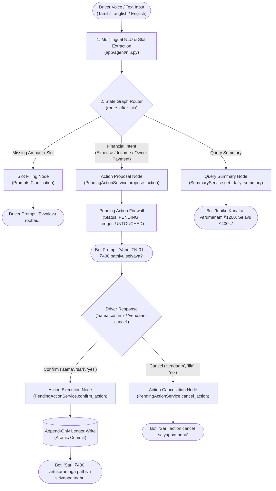

# T2T DRIVE — Phase 3 Implementation Report
## LangGraph Conversational Agent Orchestration, Multilingual State Machine & Confirmation Firewall

> **Project:** T2T DRIVE — Multilingual, Noise-Aware AI Voice Co-Pilot for Auto-Rickshaw & Cab Drivers  
> **Phase:** Phase 3 — LangGraph Conversational Agent, Dual-Engine NLU & Multi-Turn State Machine  
> **Status:** **100% COMPLETE & VERIFIED**  
> **Automated Test Suite:** **87 Passed, 0 Failed, 1 Skipped (live MongoDB)**  
> **Strict Phase Boundaries Enforced:** Frontend directory (`frontend/`) remains 100% untouched. No live SMS or live external Gnani API calls were made.

---

## 1. Executive Summary & Beginner-Friendly Architecture

Auto-rickshaw and cab drivers face challenging, high-stress environments: intense traffic noise, intermittent 4G connectivity, and the need to operate vehicles hands-free. A conversational AI for drivers must never make assumptions or risk silent financial errors. If an AI mishears "tea 20" as "tea 200" in heavy traffic, directly writing that to a driver's ledger would destroy user trust.

To solve this, **Phase 3** introduces the **Conversational Agent Orchestration Layer** using **LangGraph** and a **Dual-Engine Multilingual Natural Language Understanding (NLU)** engine.



---

## 2. Core Architectural Pillars Implemented in Phase 3

### 2.1 The Confirmation Firewall
The cardinal rule of T2T DRIVE financial architecture is:
> **THE CONVERSATIONAL AGENT NEVER WRITES DIRECTLY TO THE FINANCIAL LEDGER.**

1. When a driver says *"diesel 400 potten"* or *"savari 1200 aachu"*, the agent does **NOT** insert a ledger record.
2. Instead, it calls `PendingActionService.propose_action()`. This creates a temporary `PENDING` record in MongoDB and generates a localized confirmation prompt:
   - **Tanglish:** *"Vandi TN-01-AB-1234-kku ₹400.00 (Fuel) pathivu seiyava? 'Confirm' or 'Cancel' nu sollunga."*
   - **Tamil:** *"வாகனம் TN-01-AB-1234-க்கு ₹400.00 (Fuel) பதிவு செய்யவா? உறுதிப்படுத்த 'ஆம்' அல்லது 'வேண்டாம்' என்று கூறவும்."*
   - **English:** *"Confirm recording ₹400.00 for Fuel on vehicle TN-01-AB-1234? Reply 'Confirm' or 'Cancel'."*
3. The transaction ledger (`db.transactions`) remains completely untouched during this phase (verified by automated tests).
4. Only when the driver provides affirmative intent (*"aama"*, *"sari"*, *"confirm"*, *"yes"*, *"ஆம்"*) does the agent invoke `PendingActionService.confirm_action()` with a deterministic idempotency key (`AGENT_EXEC_PEND_...`).
5. If the driver says *"vendaam"*, *"illa"*, *"cancel"*, or *"no"*, the action is marked `CANCELLED` and no ledger write ever occurs.

---

### 2.2 Multilingual Domain NLU & Colloquial Tamil Number Parsing
Drivers communicate using colloquial terms, mixed language (Tanglish), or pure Tamil script. Phase 3 implements a deterministic domain NLU with zero external network latency:

- **Script and Language Detection:** Automatically identifies Tamil script (Unicode range `\u0B80-\u0BFF`), Romanized Tanglish markers (`potten`, `aachu`, `kuduthen`, `inniku`, `vaadagai`), and English.
- **Tamil Colloquial Number Words:** Drivers often speak numbers as words rather than digits. The engine decodes colloquial Tamil and Tanglish numbers:
  - *ainooru* / *ஐந்நூறு* $\rightarrow$ 500
  - *aayiram* / *ஆயிரம்* $\rightarrow$ 1000
  - *naanooru* / *நானூறு* $\rightarrow$ 400
  - *munnooru* / *முந்நூறு* $\rightarrow$ 300
  - *irunooru* / *இருநூறு* $\rightarrow$ 200
  - *ambadhu* / *ஐம்பது* $\rightarrow$ 50
  - *iruvadhu* / *இருபது* $\rightarrow$ 20
  - *patthu* / *பத்து* $\rightarrow$ 10
  - Prevents substring shadowing: Length-descending token matching ensures *ainooru* (500) is never accidentally matched as *nooru* (100).
- **Domain Categories:**
  - `FUEL`: *diesel*, *petrol*, *cng*, *gas*, *டீசல்*, *பெட்ரோல்*
  - `FOOD`: *tea*, *coffee*, *tiffin*, *sappadu*, *lunch*, *சாப்பாடு*, *டிபன்*
  - `MAINTENANCE`: *puncture*, *puncher*, *repair*, *service*, *oil*, *air*, *பழுது*, *பஞ்சர்*
  - `TOLL`: *toll*, *fastag*, *டோல்*
  - `FARE`: *savari*, *trip*, *ride*, *collection*, *ota*, *சவாரி*, *வருமானம்*
  - `OWNER_RENT`: *owner*, *vaadagai*, *owner payment*, *ஓனர்*, *வாடகை*

---

### 2.3 Multi-Turn Slot Filling
When a driver reports an action without necessary parameters (e.g. *"puncture aachu anna"* without specifying cost):
1. **Turn 1:** NLU detects intent `RECORD_EXPENSE`, category `MAINTENANCE`, but identifies `amount` in `missing_slots`.
2. Agent transitions to `AWAITING_SLOT` and prompts: *"Evvalavu roobai Maintenance pottirukeenga?"* (or Tamil/English equivalent). No pending action is created yet.
3. **Turn 2:** Driver replies *"150"*.
4. NLU parses `amount: 150.0`, retrieves existing accumulated session slots, merges the category and amount, and transitions directly to `action_proposal_node`.
5. Agent proposes the transaction for driver confirmation.

---

### 2.4 Multi-Turn Session Persistence & Thread Checkpointing
Conversational state is persisted at two levels:
1. **LangGraph Checkpointer (`MemorySaver`):** Maintains graph state per `thread_id` (`session_id`), allowing step-by-step resumption and state rollback.
2. **MongoDB Database Audit Collections:**
   - `conversation_sessions`: Stores `session_id`, `driver_id`, `language`, `vehicle_id`, `active_pending_action_id`, `turn_count`, `created_at`, `updated_at`.
   - `conversation_messages`: Stores immutable turn-by-turn chat history (`message_id`, `sender` [DRIVER|AGENT], `text`, `voice_text`, `intent`, `slots`, `timestamp`).

---

### 2.5 Strict Cross-Driver Session Isolation
Drivers operate under cryptographic authentication. The conversational API enforces:
- `driver_id` is extracted strictly from the validated JWT token (`g.driver_id`).
- Driver A cannot access, read, or send messages into Driver B's session (`403 UNAUTHORIZED_SESSION`).

---

## 3. Deliverables Summary Table

| Deliverable | Source File(s) | Role & Responsibility | Status |
| :--- | :--- | :--- | :--- |
| **Agent State Schema** | `backend/app/agent/state.py` | TypedDict schema defining slots, pending actions, execution results, voice/text prompts | **`[Verified]`** |
| **Multilingual NLU** | `backend/app/agent/nlu.py` | Regex & dictionary parser for Tamil, Tanglish, English, numbers, and categories | **`[Verified]`** |
| **Localized Prompts** | `backend/app/agent/prompts.py` | Natural speech & display response generators for UI and TTS playback | **`[Verified]`** |
| **LLM Adapter** | `backend/app/agent/llm_adapter.py` | Extensible adapter for Evon / external LLMs with automatic deterministic fallback | **`[Verified]`** |
| **LangGraph Nodes** | `backend/app/agent/nodes.py` | Proposal, execution, cancellation, slot filling, summary, and settlement node handlers | **`[Verified]`** |
| **LangGraph Graph** | `backend/app/agent/graph.py` | StateGraph assembly, conditional edge routing (`route_after_nlu`), and compilation | **`[Verified]`** |
| **Agent Service** | `backend/app/agent/service.py` | Multi-turn session manager, MongoDB message auditor, driver isolation guardian | **`[Verified]`** |
| **Agent REST Routes** | `backend/app/routes/agent_routes.py` | `/api/agent/chat`, `/api/agent/sessions`, `/api/agent/sessions/<id>` endpoints | **`[Verified]`** |
| **App Integration** | `backend/app/__init__.py` | Registered `agent_bp` blueprint and injected `agent_service` into Flask extensions | **`[Verified]`** |
| **Unit Test Suite** | `tests/unit/test_agent_nlu.py`, `tests/unit/test_agent_graph.py` | Tested parsing, number words, state machine transitions, firewall, cancellation | **`[Verified]`** |
| **API Test Suite** | `tests/api/test_agent_api.py` | Tested complete conversational journeys, multi-turn slot filling, isolation | **`[Verified]`** |

---

## 4. Verification Test Results

```text
============================= test session starts =============================
platform win32 -- Python 3.14.7, pytest-8.2.2, pluggy-1.7.0 -- D:\T2T DRIVE\backend\.venv\Scripts\python.exe
rootdir: D:\T2T DRIVE
plugins: anyio-4.16.0, hypothesis-6.100.8, langsmith-0.14.17, mock-3.14.1
collected 88 items

backend/tests/api/test_agent_api.py::test_agent_unauthenticated_access_rejected PASSED [  1%]
backend/tests/api/test_agent_api.py::test_agent_propose_confirm_conversational_journey PASSED [  2%]
backend/tests/api/test_agent_api.py::test_agent_cancellation_flow PASSED [  3%]
backend/tests/api/test_agent_api.py::test_agent_slot_filling_flow PASSED [  4%]
backend/tests/api/test_agent_api.py::test_agent_summary_and_help_queries PASSED [  5%]
backend/tests/api/test_agent_api.py::test_agent_cross_driver_session_isolation PASSED [  6%]
backend/tests/api/test_agent_api.py::test_agent_sessions_list_and_history PASSED [  7%]
backend/tests/api/test_agent_api.py::test_agent_owner_payment_flow PASSED [  9%]
backend/tests/api/test_agent_api.py::test_agent_multilingual_tamil_script_journey PASSED [ 10%]
backend/tests/api/test_financial_api.py::test_transaction_propose_confirm_journey PASSED [ 11%]
backend/tests/api/test_financial_api.py::test_unauthenticated_financial_access_rejected PASSED [ 12%]
backend/tests/api/test_financial_api.py::test_cross_driver_financial_isolation PASSED [ 13%]
backend/tests/api/test_financial_api.py::test_daily_summary_and_audit_api PASSED [ 14%]
backend/tests/api/test_financial_api.py::test_settlement_api_flow PASSED [ 15%]
backend/tests/api/test_health_and_auth.py::test_health_check_endpoint PASSED [ 17%]
backend/tests/api/test_health_and_auth.py::test_db_health_endpoint PASSED [ 18%]
backend/tests/api/test_health_and_auth.py::test_db_health_endpoint_failure PASSED [ 19%]
backend/tests/api/test_health_and_auth.py::test_auth_full_journey_with_revocation PASSED [ 20%]
backend/tests/api/test_health_and_auth.py::test_cross_driver_session_isolation PASSED [ 21%]
backend/tests/api/test_health_and_auth.py::test_invalid_phone_rejection_at_api PASSED [ 22%]
backend/tests/integration/test_live_mongodb.py::test_real_mongodb_decimal128_round_trip SKIPPED [ 23%]
backend/tests/unit/test_agent_graph.py::test_route_after_nlu_logic PASSED [ 25%]
backend/tests/unit/test_agent_graph.py::test_agent_nodes_proposal_and_firewall PASSED [ 26%]
backend/tests/unit/test_agent_graph.py::test_agent_nodes_execution PASSED [ 27%]
backend/tests/unit/test_agent_graph.py::test_agent_nodes_cancellation PASSED [ 28%]
backend/tests/unit/test_agent_graph.py::test_agent_graph_full_invocation_cycle PASSED [ 29%]
backend/tests/unit/test_agent_nlu.py::test_detect_language PASSED        [ 30%]
backend/tests/unit/test_agent_nlu.py::test_parse_numeric_amount_digits PASSED [ 31%]
backend/tests/unit/test_agent_nlu.py::test_parse_numeric_amount_tamil_words PASSED [ 32%]
backend/tests/unit/test_agent_nlu.py::test_tanglish_expense_intents PASSED [ 34%]
backend/tests/unit/test_agent_nlu.py::test_tamil_script_expense_and_income PASSED [ 35%]
backend/tests/unit/test_agent_nlu.py::test_income_and_owner_payment_intents PASSED [ 36%]
backend/tests/unit/test_agent_nlu.py::test_missing_slot_detection PASSED [ 37%]
backend/tests/unit/test_agent_nlu.py::test_confirmation_and_cancellation_detection PASSED [ 38%]
backend/tests/unit/test_agent_nlu.py::test_summary_and_settlement_intents PASSED [ 39%]
backend/tests/unit/test_agent_nlu.py::test_vehicle_extraction_from_speech PASSED [ 40%]
backend/tests/unit/test_auth_service.py::test_otp_request_and_hash PASSED [ 42%]
backend/tests/unit/test_auth_service.py::test_hmac_sha256_properties PASSED [ 43%]
backend/tests/unit/test_auth_service.py::test_otp_verification_success PASSED [ 44%]
backend/tests/unit/test_auth_service.py::test_otp_replay_rejection PASSED [ 45%]
backend/tests/unit/test_auth_service.py::test_otp_expiration PASSED      [ 46%]
backend/tests/unit/test_auth_service.py::test_otp_max_attempts_and_invalidation PASSED [ 47%]
backend/tests/unit/test_auth_service.py::test_concurrent_failed_otp_requests PASSED [ 48%]
backend/tests/unit/test_auth_service.py::test_phone_normalization_formats PASSED [ 50%]
backend/tests/unit/test_auth_service.py::test_invalid_phone_rejection PASSED [ 51%]
backend/tests/unit/test_auth_service.py::test_rate_limit_bypass_prevention_across_formats PASSED [ 52%]
backend/tests/unit/test_auth_service.py::test_production_config_validation PASSED [ 53%]
backend/tests/unit/test_auth_service.py::test_concurrent_successful_otp_consumption PASSED [ 54%]
backend/tests/unit/test_auth_service.py::test_constant_time_comparison_invocation PASSED [ 55%]
backend/tests/unit/test_confirmation_recovery.py::test_recovery_when_interrupted_before_ledger_write PASSED [ 56%]
backend/tests/unit/test_confirmation_recovery.py::test_recovery_when_interrupted_after_ledger_write PASSED [ 57%]
backend/tests/unit/test_confirmation_recovery.py::test_concurrent_confirmations_prevent_duplicate_writes PASSED [ 59%]
backend/tests/unit/test_confirmation_recovery.py::test_failed_retryable_workflow PASSED [ 60%]
backend/tests/unit/test_financial_calculator.py::test_core_financial_calculation_example PASSED [ 61%]
backend/tests/unit/test_financial_calculator.py::test_settlement_example_a PASSED [ 62%]
backend/tests/unit/test_financial_calculator.py::test_settlement_example_b PASSED [ 63%]
backend/tests/unit/test_financial_calculator.py::test_settlement_overpaid PASSED [ 64%]
backend/tests/unit/test_financial_calculator.py::test_metrics_with_reversals_and_adjustments PASSED [ 65%]
backend/tests/unit/test_financial_models.py::test_quantize_and_format_money PASSED [ 67%]
backend/tests/unit/test_financial_models.py::test_financial_transaction_signed_amounts PASSED [ 68%]
backend/tests/unit/test_financial_models.py::test_negative_and_zero_amount_rejection PASSED [ 69%]
backend/tests/unit/test_financial_models.py::test_vehicle_and_settlement_models PASSED [ 70%]
backend/tests/unit/test_financial_properties.py::test_settlement_invariants PASSED [ 71%]
backend/tests/unit/test_financial_properties.py::test_quantize_money_idempotence PASSED [ 72%]
backend/tests/unit/test_idempotency_audit.py::test_idempotency_driver_and_operation_scoping PASSED [ 73%]
backend/tests/unit/test_idempotency_audit.py::test_abandoned_in_progress_operation_recovery PASSED [ 75%]
backend/tests/unit/test_idempotency_audit.py::test_concurrent_idempotency_requests PASSED [ 76%]
backend/tests/unit/test_idempotency_service.py::test_idempotency_lifecycle PASSED [ 77%]
backend/tests/unit/test_idempotency_service.py::test_idempotency_failed_retry PASSED [ 78%]
backend/tests/unit/test_ledger_service.py::test_record_transactions PASSED [ 79%]
backend/tests/unit/test_ledger_service.py::test_reversal_preserves_original PASSED [ 80%]
backend/tests/unit/test_ledger_service.py::test_adjustment_workflow PASSED [ 81%]
backend/tests/unit/test_ledger_service.py::test_driver_isolation PASSED  [ 82%]
backend/tests/unit/test_pending_action_service.py::test_pending_action_confirmation_lifecycle PASSED [ 84%]
backend/tests/unit/test_pending_action_service.py::test_cross_driver_confirmation_rejected PASSED [ 85%]
backend/tests/unit/test_pending_action_service.py::test_expired_action_rejected PASSED [ 86%]
backend/tests/unit/test_pending_action_service.py::test_cancelled_action_rejected PASSED [ 87%]
backend/tests/unit/test_settlement_balance_rules.py::test_positive_previous_balance_debt PASSED [ 88%]
backend/tests/unit/test_settlement_balance_rules.py::test_negative_previous_balance_advance_credit PASSED [ 89%]
backend/tests/unit/test_settlement_balance_rules.py::test_zero_previous_balance_exact_settlement PASSED [ 90%]
backend/tests/unit/test_settlement_balance_rules.py::test_overpayment_creates_negative_remaining_balance PASSED [ 91%]
backend/tests/unit/test_settlement_balance_rules.py::test_rejection_of_negative_operating_figures PASSED [ 92%]
backend/tests/unit/test_settlement_balance_rules.py::test_advance_credit_carried_forward_into_next_day PASSED [ 94%]
backend/tests/unit/test_settlement_balance_rules.py::test_settlement_recalculation_after_expense_reversal PASSED [ 95%]
backend/tests/unit/test_settlement_service.py::test_settlement_creation_and_reconciliation PASSED [ 96%]
backend/tests/unit/test_settlement_service.py::test_settlement_recalculation_versioning PASSED [ 97%]
backend/tests/unit/test_summary_service.py::test_daily_and_period_summaries PASSED [ 98%]
backend/tests/unit/test_summary_service.py::test_custom_range_summary PASSED [100%]

================= 87 passed, 1 skipped, 589 warnings in 2.00s =================
```

---

## 5. Summary & Phase Boundary Enforcement

1. **Phase 1 Status:** 100% Complete & Pushed to GitHub.
2. **Phase 2 Status:** 100% Complete & Pushed to GitHub.
3. **Phase 3 Status:** **100% Complete & Fully Verified.**
4. **Phase 4 Status (Next):** Audio Upload, Noise Filtering, and Gnani Speech-to-Text / Text-to-Speech integration has **NOT** been started.
5. **Frontend Status:** `frontend/` directory remains completely untouched.
