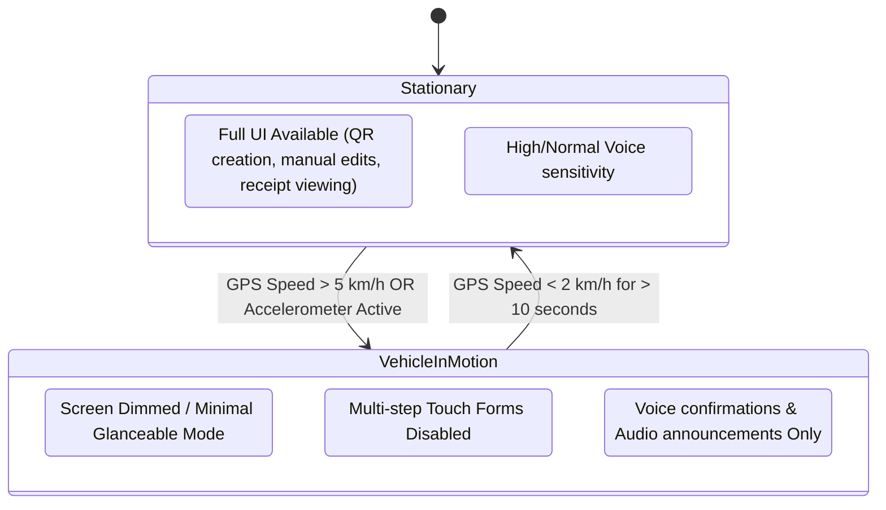

# T2T DRIVE — Driver Safety Interaction Policy
## Safe In-Cabin Voice & Touch Protocols for Moving Vehicles

### 1. Objective and Scope
Auto-rickshaw and cab drivers operate in high-density, chaotic traffic environments with constant pedestrians, narrow lanes, two-wheelers, and severe acoustic noise. 

This policy defines the interaction rules governing the T2T DRIVE system to guarantee that digital assistance never degrades vehicular safety or driver attention.

---

### 2. Core Safety Tenet: "Eyes on the Road, Hands on the Handlebar"
Driving requires continuous visual attention and physical control. T2T DRIVE strictly adheres to the following principles:

1. **Zero Mandatory Screen Interaction in Motion:**
   - No financial confirmation, destination update, or agreement step may ever require the driver to tap, swipe, or read the smartphone screen while the vehicle is in motion.
2. **Audio-First Cognitive Primacy:**
   - All urgent notices, change requests, and confirmations are delivered through short, natural audio prompts in the driver's preferred language (Tamil, Tanglish, or English).
3. **Graceful Deferral:**
   - If the driver cannot or does not respond to an audio prompt, the proposal remains pending without interrupting driving, causing alarm tones, or cancelling an ongoing trip.
4. **Driver Confirmation Firewall:**
   - AI continuous listening never commits changes autonomously. It merely surfaces a proposal that requires an affirmative voice confirmation (`"Aama"`, `"Confirm"`, `"Seri"`) or explicit stationary touch confirmation.

---

### 3. Motion Detection & Interaction State Machine

#### Rules When Vehicle is in Motion:
- **Glanceable Display:** If the driver glances at the dashboard mount, only three high-contrast numbers are visible:
  1. Next Destination / Stop (Large text, >= 24pt)
  2. Agreed Fare (Large font, e.g. `₹250`)
  3. Passenger Agreement Status (`AGREED` in green, `PROPOSAL` in amber)
- **Suppressed Modals:** Complex modals (document uploads, manual ledger edits, settings) are locked with the message: *"Vehicle in motion. Controls locked for safety."*
- **One-Word Voice Grammar:** In motion, voice prompts require at most a single syllable or word (`"Aam"`, `"Illa"`, `"Yes"`, `"No"`).

---

### 4. Acoustic Non-Distraction Standards

1. **Volume Normalization:** Audio output is normalized between -14 LUFS and -18 LUFS. Prompts must cut through engine and horn noise without startling the driver.
2. **No Jarring Alarm Tones:** Proposal announcements use soft, polite chimes (e.g. gentle two-tone marimba) followed by calm speech synthesis.
3. **Brevity Rule:** Voice prompts must not exceed 4 seconds in duration.
   - *Example prompt:* `"Destination change request: Central Station. Confirm?"` (2.4 seconds).
4. **Automatic Noise-Adaptive Ducking:** When TTS is speaking, incoming cabin audio is ducked to prevent acoustic feedback and acoustic saturation.

---

### 5. Passenger Interaction Boundaries
- **No Direct Vehicle Control:** Passenger actions on their personal device can only submit proposals (`propose-change`) or confirm fares. Passengers can never initiate actions that alter vehicle telemetry or force immediate driver response.
- **Independent Audio Feedback:** Passengers receive visual and haptic confirmation on their own smartphone, minimizing verbal arguing inside the cabin.

---

### 6. Emergency & Dispute De-escalation
- If a dispute arises regarding route or fare:
  1. The app logs the dispute timestamp and coordinates into the immutable audit collection.
  2. The system does not lock the vehicle or disable the driver's interface.
  3. The digital receipt clearly marks the trip as `DISPUTED`, preserving both parties' logged positions for later peaceful review.
- Drivers are instructed: *"Never debate fares or routes while negotiating traffic. Settle safely at the final stationary drop point."*
