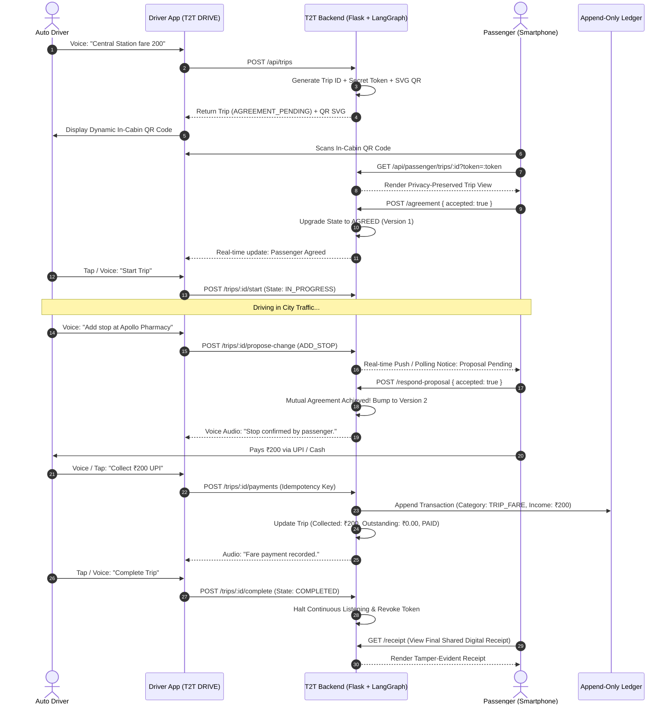
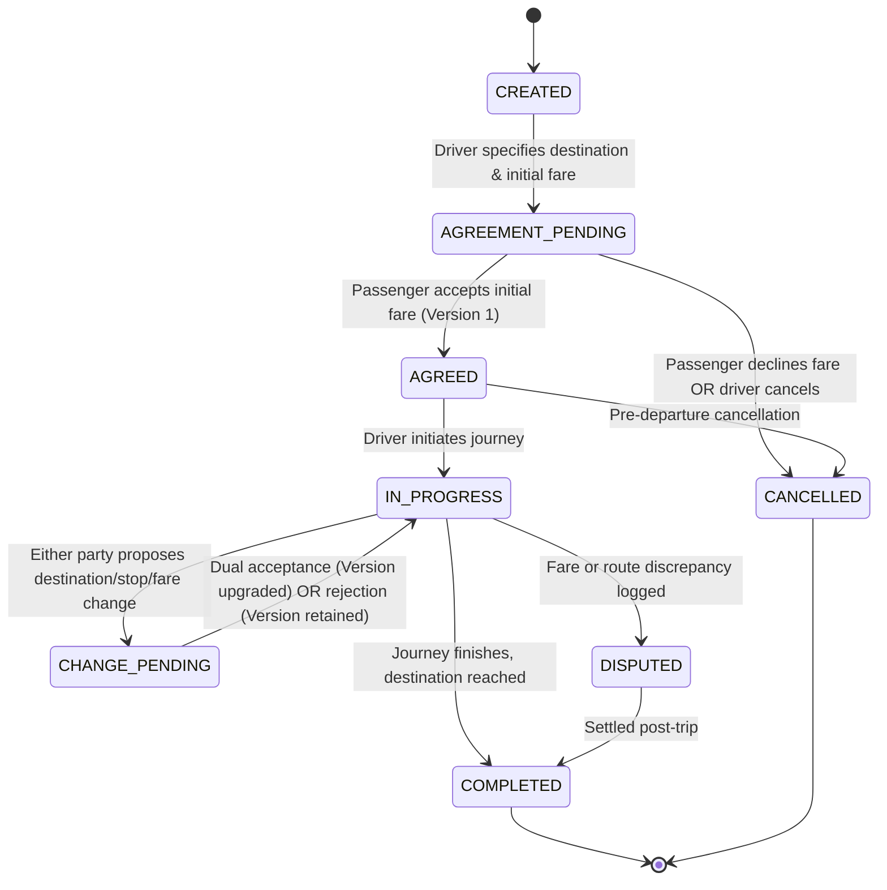

# T2T DRIVE — Passenger Trip Agreement & Reconciliation Workflow
## End-to-End Operational Lifecycle Guide

### 1. Overview
The T2T DRIVE Passenger Extension bridges the commercial divide between the driver (primary smartphone user) and the passenger (lightweight, zero-install mobile web participant).

This document details the step-by-step state transitions, cryptographic handshakes, mutual confirmation firewall rules, and financial ledger interactions that occur throughout a trip.

---

### 2. End-to-End Sequence Diagram



---

### 3. State Transition Matrix



---

### 4. Step-by-Step Lifecycle Phases

#### Phase A: Trip Initiation & In-Cabin QR Presentation
1. **Trigger:** Driver arrives at pickup or street hail. Driver says: `"Anna Nagar roundtana, fare 220"`.
2. **Backend Action:** `POST /api/trips` executes.
   - Generates unique `TRIP_XXXXXXXX`.
   - Generates 256-bit entropy token via `secrets.token_urlsafe(32)`.
   - Computes keyed HMAC-SHA-256 hash and stores in `trip_passenger_access`.
   - Generates clean, zero-network inline SVG QR code embedding URL:
     `https://<domain>/passenger.html?trip_id=TRIP_XXXX&token=YYYY`
3. **Display:** Driver dashboard renders QR code on windshield/partition phone mount.

#### Phase B: Passenger Onboarding (Zero App Installation)
1. **Passenger Action:** Points smartphone camera (iOS Camera or Android Google Lens) at the QR code.
2. **No App Barrier:** The browser opens directly into `frontend/passenger.html`.
3. **Data-Minimization Filter:** The backend serves ONLY passenger-relevant fields:
   - Vehicle registration number (`TN-01-AB-1234`).
   - Pickup & Destination locations.
   - Proposed Fare (`₹220.00`).
   - *Driver personal phone, cumulative daily earnings, and owner settlements are completely stripped.*

#### Phase C: Initial Agreement (v1)
1. **Acceptance:** Passenger taps **"Agree to Fare & Destination"**.
2. **Transition:** State shifts from `AGREEMENT_PENDING` to `AGREED`.
3. **Version Stamp:** Agreement Version 1 is created:
   ```json
   {
     "version": 1,
     "pickup_location": "Central",
     "destination_location": "Anna Nagar",
     "additional_stops": [],
     "agreed_fare": "220.00",
     "agreed_at": "2026-11-09T07:15:00Z"
   }
   ```
4. **Driver Start:** Driver taps **"Start Trip"** (or says *"Trip start pannu"*); state shifts to `IN_PROGRESS`.

#### Phase D: Mid-Trip Route Modification & Confirmation Firewall
1. **Trigger:** Passenger asks to divert to buy medicines: *"Vazhila Apollo Pharmacy-la konjam niruthunga"*.
2. **Voice Event Detection:** `TripEventClassifier` detects `POSSIBLE_ADD_STOP` with high confidence (`0.84`).
3. **Proposal Creation:**
   - Proposer: `PASSENGER` (or `DRIVER`).
   - State shifts to `CHANGE_PENDING`.
   - `active_proposal` document created.
4. **Dual Acceptance Requirement:**
   - Proposing party is marked accepted.
   - Opposing party receives an audio/screen prompt: *"Additional stop proposed: Apollo Pharmacy. Confirm?"*
   - Opposing party must explicitly confirm (`respond-proposal { accepted: true }`).
5. **Version Upgrade:**
   - Upon dual confirmation, Agreement Version increments to `v2`.
   - `v1` is permanently appended to `agreement_history`.
   - If either party declines, `active_proposal` is cleared, and active parameters remain on `v1`.

#### Phase E: Continuous Listening Consent Lifecycle
1. **Default State:** Continuous listening is strictly **OFF**.
2. **Independent Affirmative Consent:**
   - Driver must explicitly toggle consent ON.
   - Passenger must explicitly tap consent ON on their device.
3. **Immediate Revocation Purge:**
   - The instant either party withdraws consent, the server halts streaming STT, flushes RAM ring buffers, and logs a `CONSENT_UPDATED` audit record.

#### Phase F: Financial Reconciliation & Idempotency
1. **Three-Tier Accounting Isolation:**
   - **Earned Fare:** The agreed fare (`₹220.00`).
   - **Collected Amount:** Sum of verified cash/UPI payments recorded on this trip.
   - **Outstanding Balance:** `Earned Fare - Collected Amount`.
2. **Idempotent Ledger Entry:**
   - When driver records payment, `IdempotencyService` locks `idempotency_key`.
   - Appends single immutable transaction to ledger: `transaction_type="INCOME"`, `category="TRIP_FARE"`.
   - Vehicle owner rental settlement math remains unaffected and completely accurate.

#### Phase G: Trip Completion, Receipt & Token Revocation
1. **Completion:** Driver reaches destination and completes trip.
2. **Security Lockdown:**
   - Passenger token is immediately revoked in `trip_passenger_access`.
   - Continuous audio session is killed.
3. **Receipt Generation:**
   - Passenger accesses final transparent digital receipt at `/receipt`.
   - Displays complete version history, payments breakdown, and dispute hotline info.
