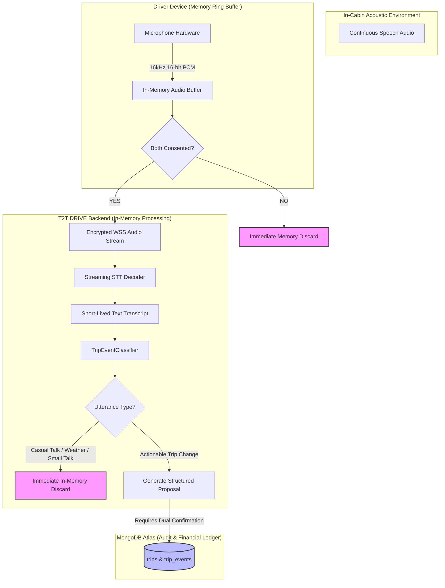

# T2T DRIVE — Privacy & Audio Data Flow Architecture
## Ephemeral In-Cabin Audio Processing, Memory-Only Buffering & Data Minimization

### 1. Privacy Mandate & Philosophy
T2T DRIVE operates in personal commercial passenger vehicles (auto-rickshaws, cabs). Passengers and drivers routinely conduct private phone calls, discuss personal financial affairs, and engage in casual conversation.

**Core Privacy Rule:**
> *Ordinary human conversation must NEVER be stored, recorded to disk, uploaded to persistent logs, or accessible in database collections. Only explicit, structured business proposals mutually agreed upon are preserved.*

---

### 2. Audio Data Flow Architecture

The table below delineates the five distinct stages of audio data and their retention lifetimes:

| Stage | Data Form | Location | Retention Lifetime | Persistent Storage? |
| :--- | :--- | :--- | :--- | :--- |
| **1. Capture** | Raw 16kHz PCM Audio Chunks | Driver Microphone Memory | < 500 ms (Frame duration) | **NO** (Overwritten in ring buffer) |
| **2. Stream** | TLS 1.3 WebSocket Chunks | Encrypted Network Transit | Real-time transit | **NO** (Transient stream) |
| **3. STT Inference** | ASR Intermediate Hypotheses | Memory of STT Engine | Real-time decoding (< 300 ms) | **NO** (Provider zero-retention contract) |
| **4. Ephemeral Transcript** | Text string (Tamil/Tanglish/English) | Backend In-Memory Process | < 2 seconds (NLU Classifier evaluation) | **NO** (Discarded immediately if casual) |
| **5. Business Event** | Structured JSON (`TripChangeProposal`) | MongoDB Atlas `trips` collection | Trip lifecycle + audit retention | **YES** (Only if mutual agreement is reached) |



---

### 3. Detailed Stage Protocols

#### Stage 1: Client Capture
- Audio is acquired via Web Audio API `AudioWorkletNode` in 16-bit linear PCM format at 16,000 Hz.
- Buffer size is capped at 4096 samples (256 milliseconds).
- Audio frames are piped directly to the streaming socket; no audio files (`.wav`, `.mp3`) are written to the driver's local storage during continuous listening.

#### Stage 2: Dual Consent Enforcement Gate
- Before any audio frame leaves the device, the client checks `trip.consent_state.continuous_listening_active`.
- If either the driver or passenger has revoked consent:
  - Audio capture is instantly suspended at the hardware level.
  - Existing client ring buffers are zero-filled (`memset 0`).
  - The server terminates the WebSocket session.

#### Stage 3: Streaming Provider Retention Disclosure
- **Provider:** Gnani.ai Prisma STT.
- **Enterprise Agreement Terms:**
  - Real-time streaming STT operates under strict **Data Processing Agreement (DPA)** with **Zero Data Retention (ZDR)**.
  - Audio payloads sent to `wss://api.vachana.ai/stt/v3/stream` are processed ephemerally in RAM for acoustic acoustic model decoding.
  - No raw audio or text transcripts are logged to provider storage, persistent disks, or used for model retraining without express out-of-band consent.
- **Mock Fallback Isolation:** When `VOICE_PROVIDER_MODE=mock`, all audio processing remains completely localized on the host server without outbound network transmission.

#### Stage 4: In-Memory Classification & Discard Engine
- As transcripts are emitted by the STT stream, `ContinuousListeningService.process_in_memory_transcript` evaluates the string:
  ```python
  utterance_type, entities, confidence = self.classifier.classify_utterance(transcript)
  ```
- **Rule 1 (Privacy Filter):**
  If `utterance_type` is `GENERAL_CONVERSATION`, `GENERAL_QUESTION`, or `HYPOTHETICAL`:
  - The Python string is dereferenced immediately.
  - `discarded_conversations` counter is incremented in memory metrics.
  - **Zero bytes are written to MongoDB Atlas, log files, or Redis.**
- **Rule 2 (Actionable Gate):**
  Only when an explicit trip intent is identified with high statistical confidence (`confidence >= 0.70` for stops/destinations, `>= 0.75` for fares):
  - The system extracts only the entity (e.g. `{"destination_location": "Airport"}`).
  - A structured proposal is persisted to `trips.active_proposal`.
  - The raw transcript that gave rise to the proposal is **never stored** in the document.

---

### 4. Passenger Privacy Protections
1. **Zero Registration / Zero Tracker:**
   - Passengers never download an application or sign up with an email, phone number, or social account.
   - Access is authorized via a one-time cryptographic URL (`secrets.token_urlsafe(32)`).
2. **Access Token Scoping & Revocation:**
   - Tokens are hashed with HMAC-SHA-256 before storage.
   - Tokens expire automatically 24 hours after creation.
   - The moment a trip transitions to `COMPLETED` or `CANCELLED`, `passenger_access_service.revoke_access(trip_id)` renders the link permanently invalid.
3. **Data-Minimizing Passenger View:**
   - When the passenger opens their mobile web interface, the API filters out:
     - Driver's private phone number.
     - Driver's daily income and cumulative earnings.
     - Vehicle owner rental settlement details.
     - Internal audit logs and diagnostic SNR metrics.

---

### 5. Compliance with DPDP Act 2023 (India)
T2T DRIVE complies with India's **Digital Personal Data Protection Act, 2023 (DPDP)**:
- **Affirmative Notice & Consent (Section 6):** Independent, granular consent from both driver and passenger prior to processing in-cabin acoustic data.
- **Purpose Limitation (Section 7):** Audio is processed solely for destination and fare agreement management during the active trip.
- **Immediate Erasure (Section 8):** Non-actionable audio and transcripts are erased in real-time within RAM without persistent traces.
