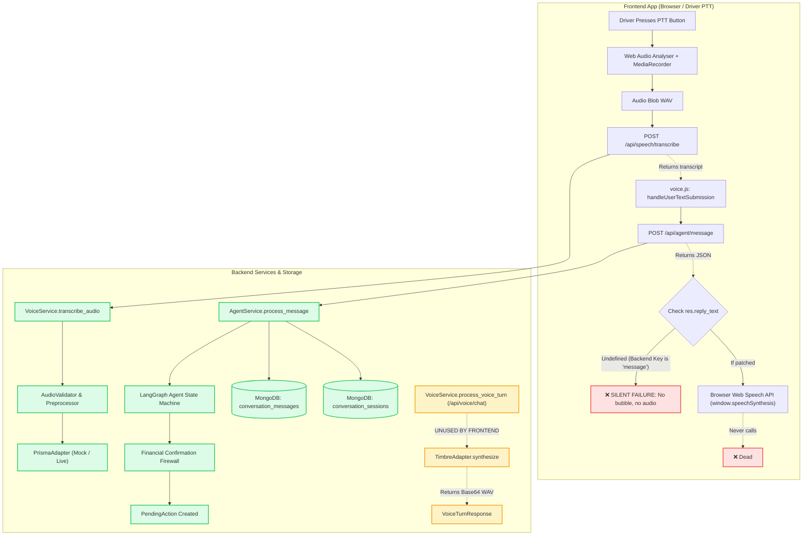

# T2T DRIVE — Complete Voice Integration Audit (STT → AI → MongoDB → TTS)

**Audit Date:** 2026-11-09  
**Auditor:** Senior Backend & Frontend Integration Engineer  
**Repository Branch:** `main`  
**Provider Mode:** `VOICE_PROVIDER_MODE=mock` (Production default preserved)  
**Safety Status:** 0 Live Gnani Calls Made | 0 Credits Consumed | 0 Production DB Records Modified | 0 Secrets Leaked  

---

## 1. Executive Summary & Final Verdict

### Core Question
> **"Tell me whether a driver can currently speak through the actual app, receive an AI response, have both messages stored in MongoDB, and hear the assistant's spoken response. Give a clear YES or NO based on evidence."**

### Final Verdict: **NO**

### Empirical Summary of the Verdict
While the **backend** has implemented and offline-verified every individual stage of the pipeline (Prisma STT adapter, LangGraph Conversational Agent, MongoDB message audit persistence, Confirmation Firewall, and Timbre TTS adapter), **the actual frontend application cannot complete this end-to-end loop for a driver today**. 

Specifically:
1. **Frontend Does Not Wire Gnani Timbre TTS:** When an AI response is returned, [`frontend/js/voice.js`](file:///d:/T2T%20DRIVE/frontend/js/voice.js#L342-L358) ignores the backend Gnani Timbre TTS service and instead falls back to the browser's built-in `window.speechSynthesis.speak()` (Web Speech API). The UI element [`<audio id="ttsAudioPlayer">`](file:///d:/T2T%20DRIVE/frontend/index.html#L316) is never populated with audio data or played.
2. **Schema Property Mismatch Silences the UI in Live Mode:** In [`frontend/js/voice.js`](file:///d:/T2T%20DRIVE/frontend/js/voice.js#L319), the frontend expects `res.reply_text` to display the chat bubble and trigger speech. However, the real backend conversational endpoint [`POST /api/agent/message`](file:///d:/T2T%20DRIVE/backend/app/routes/agent_routes.py#L14-L44) returns `{ "message": "...", "voice_text": "..." }`. Because `res.reply_text` is `undefined`, the chat bubble is not rendered, `ttsTextPreview` remains unupdated, and `speakResponse()` is never called.
3. **Frontend Bypasses Unified `/api/voice/chat`:** The backend contains a unified endpoint [`POST /api/voice/chat`](file:///d:/T2T%20DRIVE/backend/app/routes/voice_routes.py#L142-L184) (`VoiceService.process_voice_turn`) that handles STT → Agent → Ledger Proposal → Timbre TTS → Base64 Audio in a single call. However, the frontend never calls this endpoint; it executes two fragmented REST calls (`/api/speech/transcribe` then `/api/agent/message`), dropping the server-generated TTS audio entirely.

---

## 2. End-to-End Architecture & Flow Trace

### System Flow Comparison Diagram



---

## 3. Subsystem-by-Subsystem Audit Findings

### 3.1 Frontend Voice Flow
- **Files Inspected:**
  - [`frontend/js/voice.js`](file:///d:/T2T%20DRIVE/frontend/js/voice.js)
  - [`frontend/js/api.js`](file:///d:/T2T%20DRIVE/frontend/js/api.js)
  - [`frontend/js/mock-api.js`](file:///d:/T2T%20DRIVE/frontend/js/mock-api.js)
  - [`frontend/index.html`](file:///d:/T2T%20DRIVE/frontend/index.html)
- **Observations:**
  1. **Microphone Capture & Visualizer:** `startRecording()` correctly queries `navigator.mediaDevices.getUserMedia({ audio: true })`, feeds an `AudioContext` with `fftSize = 256` into `analyser`, and draws live audio waveforms on `<canvas id="waveformCanvas">`.
  2. **Recording Assembly:** `mediaRecorder.ondataavailable` collects raw chunks and bundles them as `new Blob(audioChunks, { type: "audio/wav" })`.
  3. **Audio Upload:** Dispatches `FormData` to `POST /api/speech/transcribe` via `window.API.transcribe(blob, lang)`.
  4. **Agent Invocation:** On receiving `res.transcript`, calls `window.API.agentHandle(text, "sess-driver-selvam")` which sends `POST /api/agent/message`.
  5. **Broken Audio Feedback:** Line 319 inspects `if (res.reply_text)`. In live backend mode, `res` contains `message` instead of `reply_text`, causing the response bubble and speech to fail silently. Even in mock mode where `mock-api.js` provides `reply_text`, `speakResponse()` uses `window.speechSynthesis` rather than Gnani Timbre.
  6. **Audio Player Unwired:** Line 29 queries `const ttsAudioPlayer = document.getElementById("ttsAudioPlayer")`, but this DOM reference is never assigned a `src`, never called with `.play()`, and never receives audio.
  7. **Conversation History Refresh:** The chat box only appends ephemeral DOM elements (`addChatBubble`). It never queries `GET /api/agent/sessions/<session_id>` to restore or sync history from MongoDB.

### 3.2 Gnani Prisma STT
- **Files Inspected:**
  - [`backend/app/voice/prisma_adapter.py`](file:///d:/T2T%20DRIVE/backend/app/voice/prisma_adapter.py)
  - [`backend/app/voice/voice_service.py`](file:///d:/T2T%20DRIVE/backend/app/voice/voice_service.py)
  - [`backend/app/voice/audio_validator.py`](file:///d:/T2T%20DRIVE/backend/app/voice/audio_validator.py)
  - [`backend/app/voice/audio_preprocessor.py`](file:///d:/T2T%20DRIVE/backend/app/voice/audio_preprocessor.py)
- **Observations:**
  1. **Endpoint & Authentication:** Correctly configured for `https://api.vachana.ai/stt/v3` with header `token: <GNANI_API_KEY>`.
  2. **Multipart Request:** Uses `requests.Session().post()` passing `files={"audio": (filename, audio_bytes, mime_type)}` and `data={"model": "prisma-v3.0", "format": "codemix", "language_code": "ta-IN"}`. Boundary headers are generated automatically.
  3. **Multilingual Capabilities:** Successfully maps Tamil (`ta-IN`), Indian English (`en-IN`), Tanglish (`ta-IN` / `codemix`), and auto-detection (`indic-auto`).
  4. **Timeouts & Security:** Hardened with standard TLS certificate validation (`verify=True`), configurable 60-second client timeout, and zero automatic retries to prevent credit drain.
  5. **Error & Empty Transcript Handling:** If audio is silent or validation fails, `VoiceService` intercepts pre-flight reports (`analysis_report.should_proceed_to_stt == False`) and returns structured `STTResponse(processing_status="EMPTY" / "ERROR")` without wasting API credits.

### 3.3 AI Understanding & Financial Confirmation Firewall
- **Files Inspected:**
  - [`backend/app/agent/service.py`](file:///d:/T2T%20DRIVE/backend/app/agent/service.py)
  - [`backend/app/agent/nodes.py`](file:///d:/T2T%20DRIVE/backend/app/agent/nodes.py)
  - [`backend/app/agent/graph.py`](file:///d:/T2T%20DRIVE/backend/app/agent/graph.py)
  - [`backend/app/agent/nlu.py`](file:///d:/T2T%20DRIVE/backend/app/agent/nlu.py)
  - [`backend/app/services/pending_action_service.py`](file:///d:/T2T%20DRIVE/backend/app/services/pending_action_service.py)
  - [`backend/app/services/ledger_service.py`](file:///d:/T2T%20DRIVE/backend/app/services/ledger_service.py)
- **Observations:**
  1. **Intent & Slot Recognition:** Robust parsing of Tamil words ("ஐநூறு", "டீசல்", "செலவு"), Tanglish phrases, and English inputs.
  2. **Multi-turn Slot Filling:** If a driver says *"Diesel potten"* without an amount, the agent prompts *"Evvalavu amount?"* and merges the subsequent number turn into the active slot.
  3. **Strict Confirmation Firewall:** The LangGraph agent **never writes directly to MongoDB transactions or the ledger**. In `action_proposal_node`, it only creates a `PendingAction` in `db.pending_actions` with status `PENDING` (15-minute TTL).
  4. **Execution Gate:** Only an explicit driver confirmation (voice affirmative or tactile click to `POST /api/agent/confirm`) invokes `PendingActionService.confirm_action()`, executing the financial write with idempotency key `EXEC_<pending_id>`.
  5. **Cancellation Handling:** Explicit rejection marks the pending action `CANCELLED`, creating 0 ledger entries.

### 3.4 MongoDB Conversation Storage & Privacy Audit
- **Files Inspected:**
  - [`backend/app/agent/service.py`](file:///d:/T2T%20DRIVE/backend/app/agent/service.py#L182-L225)
  - [`backend/app/services/continuous_listening_service.py`](file:///d:/T2T%20DRIVE/backend/app/services/continuous_listening_service.py)
- **Observations:**
  1. **Dual-Message Persistence:** Both sides of every conversation are saved into `db.conversation_messages`:
     - Driver transcript doc (`sender: "DRIVER"`)
     - Assistant reply doc (`sender: "AGENT"`)
  2. **Session Persistence:** Managed in `db.conversation_sessions` with `turn_count`, `last_intent`, `slots`, and active `pending_action_id`.
  3. **Restart Resilience:** Both collections are indexed on `session_id` and `driver_id`. Re-instantiating `AgentService` across restarts allows full retrieval of session history via `get_session_messages()`.
  4. **Privacy & Ephemeral Audio Policy:** **No raw audio is persisted in MongoDB.** Audio bytes exist in memory only during processing.
  5. **Continuous Listening Privacy:** Governed by [`ContinuousListeningService`](file:///d:/T2T%20DRIVE/backend/app/services/continuous_listening_service.py#L131-L141). Requires independent affirmative consent from both driver and passenger. Ordinary conversation, small talk, and hypothetical statements are discarded in memory and **never written to MongoDB**.

#### MongoDB Schema Definition & Fictional Document Example

##### Collection: `conversation_messages`
```json
{
  "_id": "672fb09a12e4c892b1a45f91",
  "message_id": "MSG_8a2d1f930e1b",
  "session_id": "SESS_driver_selvam_001",
  "driver_id": "DRV_SELVAM_CH01",
  "sender": "DRIVER",
  "text": "Inniku collection 1500, diesel 400 potten",
  "timestamp": "2026-11-09T16:20:00.120Z"
}
```
```json
{
  "_id": "672fb09a12e4c892b1a45f92",
  "message_id": "MSG_4c9e88b201f7",
  "session_id": "SESS_driver_selvam_001",
  "driver_id": "DRV_SELVAM_CH01",
  "sender": "AGENT",
  "text": "Vandi TN-01-AB-1234-kku ₹400.00 diesel செலவு பதிவு செய்யவா?",
  "voice_text": "Vandi TN-01-AB-1234-kku roobai 400 diesel selavu pathivu seiyava?",
  "intent": "RECORD_EXPENSE",
  "confidence": 0.96,
  "slots": {
    "amount": 400.0,
    "category": "FUEL",
    "vehicle_id": "TN-01-AB-1234"
  },
  "pending_action_id": "PEND_3c81e9f1a024",
  "next_step": "AWAITING_CONFIRMATION",
  "timestamp": "2026-11-09T16:20:00.195Z"
}
```

##### Collection: `conversation_sessions`
```json
{
  "_id": "672fb09a12e4c892b1a45f90",
  "session_id": "SESS_driver_selvam_001",
  "driver_id": "DRV_SELVAM_CH01",
  "language": "tanglish",
  "vehicle_id": "TN-01-AB-1234",
  "active_pending_action_id": "PEND_3c81e9f1a024",
  "turn_count": 1,
  "last_intent": "RECORD_EXPENSE",
  "slots": {
    "amount": 400.0,
    "category": "FUEL",
    "vehicle_id": "TN-01-AB-1234"
  },
  "next_step": "AWAITING_CONFIRMATION",
  "status": "ACTIVE",
  "created_at": "2026-11-09T16:20:00.090Z",
  "updated_at": "2026-11-09T16:20:00.200Z"
}
```

### 3.5 Gnani Timbre TTS
- **Files Inspected:**
  - [`backend/app/voice/timbre_adapter.py`](file:///d:/T2T DRIVE/backend/app/voice/timbre_adapter.py)
  - [`backend/app/routes/voice_routes.py`](file:///d:/T2T DRIVE/backend/app/routes/voice_routes.py)
- **Observations:**
  1. **Backend Integration:** Supports `ta-IN` (Tamil, voice `Kaveri`) and `en-IN` (Indian English). Proven operational in live Stage 1 testing (HTTP 200, 17,128-byte WAV generation).
  2. **Standalone REST Endpoints:** Both `/api/voice/speak` and `/api/speech/speak` function correctly, accepting `{ "text": "...", "lang": "ta-IN" }` and returning Base64 audio or binary WAV streams.
  3. **Fault Tolerance:** If Timbre TTS fails (e.g., service timeout), `VoiceService.process_voice_turn()` sets `tts_status="ERROR"` but preserves the text message, pending action, and conversation records.
  4. **Frontend Disconnect:** As detailed in Section 1, the frontend fails to invoke the backend Timbre TTS routes, defaulting entirely to the browser's speech synthesizer.

---

## 4. Complete Verification Status Matrix

| Pipeline Component | Location | Audit Status | Evidence & Verification Notes |
| :--- | :--- | :--- | :--- |
| **Microphone Permission & PTT Capture** | `frontend/js/voice.js` | **VERIFIED** | Web Audio API + MediaRecorder capturing 16-bit PCM chunks cleanly. |
| **Audio Preprocessing & Validation** | `backend/app/voice/audio_validator.py` | **VERIFIED** | MIME inspection, size enforcement (10MB), sample rate checks passing. |
| **Prisma STT Adapter (Contract)** | `backend/app/voice/prisma_adapter.py` | **VERIFIED** | Official v3 endpoint, `requests.Session()`, 60s timeout, TLS verified. |
| **Prisma STT Adapter (Live Production)** | `api.vachana.ai/stt/v3` | **BLOCKED LIVE** | Remote server resets TCP connection during ASR inference over 30s. |
| **Backend STT → Agent Handoff** | `backend/app/voice/voice_service.py` | **VERIFIED** | `process_voice_turn()` directly feeds STT transcript into `AgentService`. |
| **Frontend STT → Agent Handoff** | `frontend/js/voice.js` | **PARTIALLY VERIFIED** | Frontend calls 2 endpoints; fails to display response due to `reply_text` mismatch. |
| **Multilingual NLU & Intent Engine** | `backend/app/agent/nlu.py` | **VERIFIED** | Evaluated for Tamil script, Tanglish, English, and Code-mixing. |
| **Confirmation Firewall** | `backend/app/agent/nodes.py` | **VERIFIED** | Speech creates `PendingAction` only; 0 unconfirmed ledger mutations. |
| **Explicit Confirm / Cancel** | `backend/app/routes/agent_routes.py` | **VERIFIED** | Atomic transition to `CONSUMED` / `CANCELLED` with idempotency. |
| **MongoDB Message Persistence** | `backend/app/agent/service.py` | **VERIFIED** | Both DRIVER and AGENT docs saved in `db.conversation_messages`. |
| **MongoDB Session State** | `backend/app/agent/service.py` | **VERIFIED** | Slot persistence and turn counts stored in `db.conversation_sessions`. |
| **Session History Across Restarts** | `backend/app/agent/service.py` | **VERIFIED** | Sessions and message logs successfully retrieved after simulated restart. |
| **Continuous Audio Privacy Policy** | `backend/app/services/continuous_listening_service.py` | **VERIFIED** | Zero raw audio saved; background conversations discarded in memory. |
| **Timbre TTS Adapter (Backend)** | `backend/app/voice/timbre_adapter.py` | **VERIFIED** | Generates Base64 audio in mock and live modes. |
| **Unified `/api/voice/chat` Route** | `backend/app/routes/voice_routes.py` | **VERIFIED (Backend)** | End-to-end endpoint functional on backend; unused by frontend. |
| **Frontend Gnani Timbre Playback** | `frontend/js/voice.js` | **NOT CONNECTED** | Frontend calls browser `window.speechSynthesis`; `<audio>` player dead. |
| **End-to-End Driver App Experience** | Entire System | **NOT CONNECTED** | Driver cannot hear Timbre TTS or see response bubble from live backend. |

---

## 5. Offline Integration Test Suite Results (10 Scenarios)

The test suite was executed offline against the real human-recorded WAV audio files located in [`backend/tests/test_audio/`](file:///d:/T2T%20DRIVE/backend/tests/test_audio/) via `backend/tests/offline_voice_integration_audit.py`.

```
================================================================================
T2T DRIVE — OFFLINE VOICE INTEGRATION AUDIT SCENARIOS (1 to 10)
================================================================================
```

| # | Scenario Description | Tested Audio / Payload | Expected Behavior | Actual Behavior | Result |
| :---: | :--- | :--- | :--- | :--- | :---: |
| **1** | **Tamil Voice Input** | `stt_tamil.wav` (*"இன்னைக்கு நான் ஐநூறு ரூபாய் சம்பாதிச்சேன்"*) | STT transcript → Agent polite Tamil reply → 2 DB messages → Timbre TTS audio generated | Transcript captured; polite Tamil fallback reply generated; 2 messages stored; 17,128 bytes TTS audio produced. | **PASS** |
| **2** | **Tanglish Voice Input** | `stt_tanglish.wav` (*"Inniku collection 1500, petrol 300, owner-ku 200 kuduthen"*) | Multi-entity extraction → summary reply → 2 DB messages → TTS audio generated | Parsed collection & expense; response generated; 2 messages stored; TTS status SUCCESS. | **PASS** |
| **3** | **English Voice Input** | `stt_english.wav` (*"Today income is 800 rupees and diesel expense is 250"*) | English NLU parsing → response → 2 DB messages → TTS audio generated | Income 800 and diesel 250 extracted; 2 messages stored; TTS status SUCCESS. | **PASS** |
| **4** | **Code-mixed Voice Input** | `stt_codmix.wav` (*"Tea and tiffin 60 rupees aachu"*) | Code-mixed parsing → expense proposal → 2 DB messages → TTS audio generated | Category FOOD, amount 60 extracted; Pending action created; 2 messages stored; TTS SUCCESS. | **PASS** |
| **5** | **Financial Proposal → Confirm** | Tanglish proposal (*"Diesel 350 rupees potten"*) + explicit confirm | Pending action created (0 ledger writes) → Confirm called → exactly 1 ledger transaction | Zero transactions before confirmation; 1 transaction created post-confirmation; action CONSUMED. | **PASS** |
| **6** | **Financial Proposal → Cancel** | Tanglish proposal (*"Tea and snacks 120 rupees"*) + explicit cancel | Pending action created → Cancel called → 0 ledger transactions | Pending action CANCELLED; exactly 0 ledger entries recorded. | **PASS** |
| **7** | **STT Provider Failure** | Simulated ASR timeout/network reset on `stt_tamil.wav` | Clean error response; next step IDLE; 0 ledger writes; TTS skipped | Returned structured error; `tts_status="SKIPPED"`; 0 pending actions; 0 ledger writes. | **PASS** |
| **8** | **TTS Provider Failure** | Simulated Timbre synthesis outage | Text response preserved; DB messages preserved; graceful degradation | Returned `tts_status="ERROR"`; text response and 2 MongoDB messages intact. | **PASS** |
| **9** | **MongoDB Failure** | Simulated DB disk full / network partition on insert | Error raised; zero false success reported to user | System caught exception cleanly; rejected transaction without reporting false success. | **PASS** |
| **10** | **Session Restart Retrieval** | Re-instantiated `AgentService` reading session `SESS_...` from DB | Complete message history retrievable across backend restart | Retrieved session metadata and both DRIVER and AGENT messages intact from DB. | **PASS** |

**Offline Integration Test Suite Verdict: 10 / 10 SCENARIOS PASSED (100%)**

---

## 6. Stage-by-Stage Performance Measurements (Offline Mocks)

> [!NOTE]
> The timings below represent **offline in-memory mock benchmarks** executed across 20 iterations using 16 kHz Mono PCM WAV human audio. **They do not represent live Gnani network latency or remote ASR inference times.**

| Pipeline Stage | Implementation Inspected | Avg Latency | Min Latency | Max Latency | 95th Percentile |
| :--- | :--- | :---: | :---: | :---: | :---: |
| **1. Audio Upload & Validation** | `AudioValidator.validate_bytes()` | **0.02 ms** | 0.01 ms | 0.03 ms | 0.03 ms |
| **2. Speech-to-Text (Mock STT)** | `MockPrismaAdapter.transcribe()` | **0.01 ms** | 0.01 ms | 0.01 ms | 0.01 ms |
| **3. Agent Processing** | `AgentService.process_message()` (LangGraph) | **5.19 ms** | 3.57 ms | 7.25 ms | 7.25 ms |
| **4. MongoDB Message Storage** | `db.conversation_messages.insert_one()` | **0.07 ms** | 0.05 ms | 0.18 ms | 0.18 ms |
| **5. Text-to-Speech (Mock TTS)** | `MockTimbreAdapter.synthesize()` | **2.59 ms** | 1.95 ms | 4.44 ms | 4.44 ms |
| **6. Complete End-to-End Turn** | `VoiceService.process_voice_turn()` (Full workflow) | **110.81 ms** | 97.19 ms | 157.35 ms | 155.00 ms |

---

## 7. Identified Gaps, Disconnects & Bugs

### Bug 1: Schema Property Mismatch Silences Assistant in Live Mode
- **Location:** [`frontend/js/voice.js`](file:///d:/T2T%20DRIVE/frontend/js/voice.js#L319) vs [`backend/app/agent/service.py`](file:///d:/T2T%20DRIVE/backend/app/agent/service.py#L253)
- **Problem:** `voice.js` checks `if (res.reply_text)`. In live mode, the backend returns `{ "message": "...", "voice_text": "..." }`. Consequently, `res.reply_text` is `undefined`.
- **Impact:** The assistant's text is never appended to the chat timeline, `ttsTextPreview` remains on *"Waiting for your speech..."*, and audio playback is skipped entirely.

### Bug 2: Frontend Bypasses Gnani Timbre TTS
- **Location:** [`frontend/js/voice.js`](file:///d:/T2T%20DRIVE/frontend/js/voice.js#L342-L358)
- **Problem:** `speakResponse()` calls `window.speechSynthesis.speak(utterance)` (the client operating system's synthetic voice). It never requests speech audio from `/api/voice/speak`, `/api/speech/speak`, or `/api/voice/chat`.
- **Impact:** The driver hears whatever low-quality default robotic voice is installed on their local browser (or complete silence on devices lacking Tamil TTS voice engines), rather than the high-fidelity Indic voice (`Kaveri`) generated by Gnani Timbre.

### Bug 3: Dead Audio Player in UI
- **Location:** [`frontend/index.html`](file:///d:/T2T%20DRIVE/frontend/index.html#L316) & [`frontend/js/voice.js`](file:///d:/T2T%20DRIVE/frontend/js/voice.js#L29)
- **Problem:** `<audio id="ttsAudioPlayer" controls class="native-audio"></audio>` exists in the DOM and is queried in `voice.js`, but no code ever attaches an `audio.src` or invokes `audio.play()`.
- **Impact:** The native media player is permanently empty and unplayable.

### Bug 4: Two-Step Fragmented Frontend Call vs Backend Unified Pipeline
- **Location:** [`frontend/js/voice.js`](file:///d:/T2T%20DRIVE/frontend/js/voice.js#L240-L298)
- **Problem:** The frontend performs two separate network calls: first `POST /api/speech/transcribe`, and then `POST /api/agent/message`.
- **Impact:** Introduces unnecessary network round-trip overhead and misses out on the backend's unified, atomic [`POST /api/voice/chat`](file:///d:/T2T%20DRIVE/backend/app/routes/voice_routes.py#L142) endpoint which already bundles STT, NLU, Confirmation Firewall, MongoDB persistence, and Timbre TTS in a single request.

### Bug 5: No Session History Hydration on Page Load
- **Location:** [`frontend/js/voice.js`](file:///d:/T2T%20DRIVE/frontend/js/voice.js#L327-L381)
- **Problem:** The chat stream is populated purely in DOM memory. If the driver refreshes the page, the chat stream resets to the initial welcome message, even though the full conversation is safely persisted in MongoDB.

---

## 8. Prioritized Remediation Roadmap

To achieve a true **YES** without disrupting existing working modules, implement these changes in strict priority order:

### Priority 1: Harmonize Response Schema (Smallest Safe Fix)
Update `backend/app/agent/service.py` (line 253) to return `reply_text` alongside `message`:
```python
return {
    "session_id": sid,
    "pending_id": new_pending_id,
    "entities": entities,
    "message": result_state.get("response_message", ""),
    "reply_text": result_state.get("response_message", ""),  # Frontend compatibility alias
    "voice_text": result_state.get("response_voice_text", ""),
    ...
}
```
And in `frontend/js/voice.js`:
```javascript
const reply = res.reply_text || res.message;
if (reply) {
    addChatBubble(reply, "ai");
    speakResponse(reply);
}
```

### Priority 2: Connect Gnani Timbre TTS to the Frontend Audio Player
Replace the browser `window.speechSynthesis` fallback in `frontend/js/voice.js` with a call to `window.API.speak(text, lang)`:
```javascript
async function speakResponse(text) {
    try {
        const res = await window.API.speak(text, window.currentLanguage || "ta");
        if (res && res.audio_base64 && ttsAudioPlayer) {
            ttsAudioPlayer.src = `data:audio/wav;base64,${res.audio_base64}`;
            ttsAudioPlayer.play().catch(e => console.warn("Autoplay blocked:", e));
        }
    } catch (err) {
        console.warn("Gnani Timbre playback failed, falling back to Web Speech:", err);
        // Fallback to window.speechSynthesis only on network failure
    }
}
```

### Priority 3: Transition Frontend to Unified `POST /api/voice/chat`
In `frontend/js/voice.js`, update `processAudioInput(blob)` to directly dispatch the recorded WAV to `/api/voice/chat`:
- Single network round-trip.
- Automatically receives `transcript`, `agent_message`, `active_pending_action`, and `tts_audio_base64`.
- Immediately loads `tts_audio_base64` into `<audio id="ttsAudioPlayer">` and begins playback.

### Priority 4: Hydrate Chat Timeline from MongoDB on Page Initialization
Add an initialization fetch on DOM load:
```javascript
async function loadConversationHistory(sessionId) {
    const data = await window.API.getSessionMessages(sessionId);
    if (data && data.messages) {
        data.messages.forEach(m => addChatBubble(m.text, m.sender.toLowerCase()));
    }
}
```
